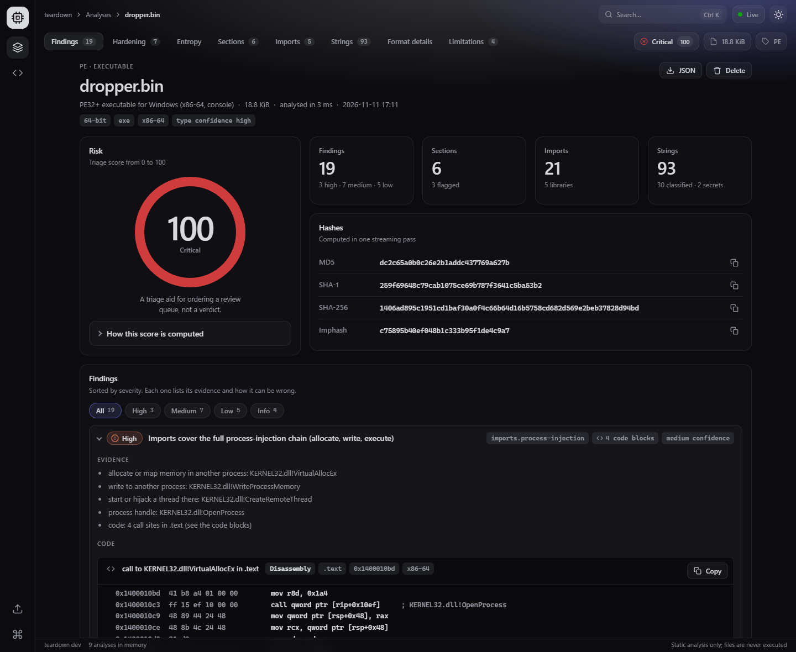
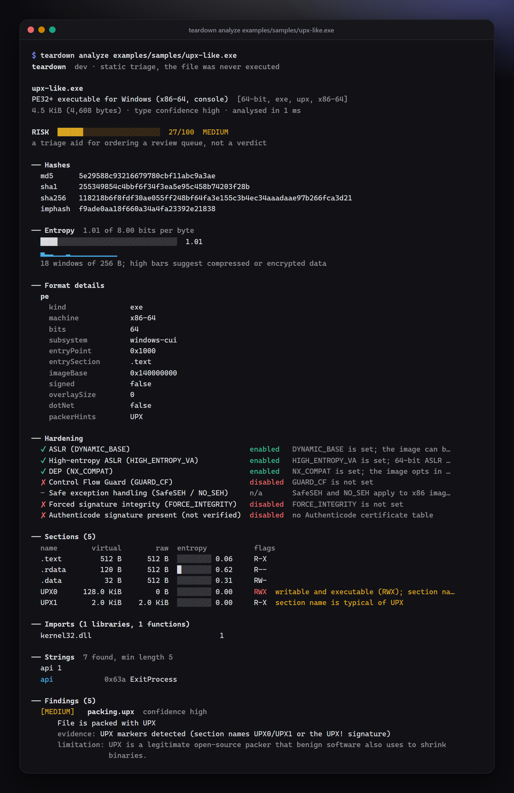
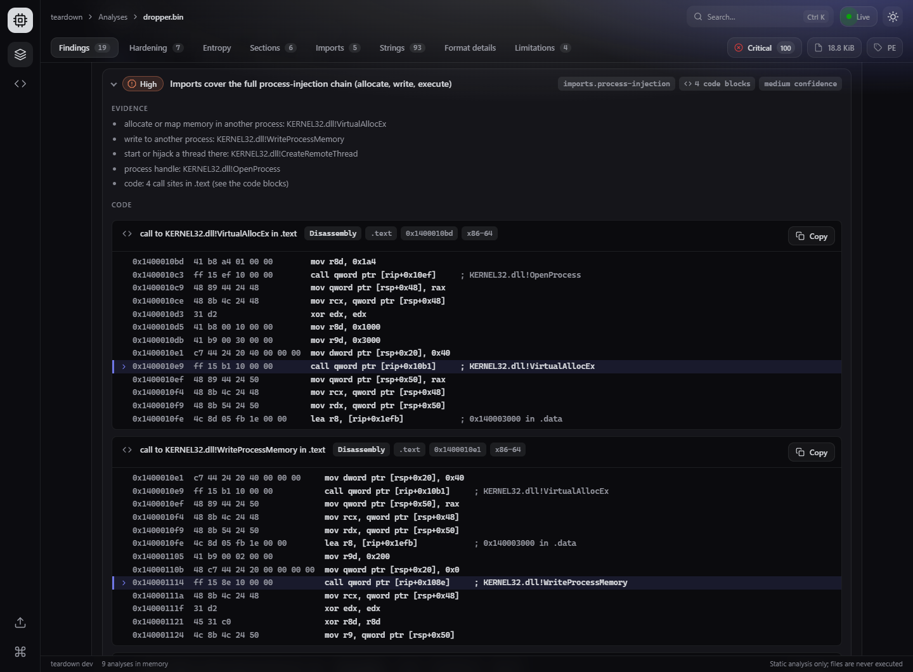
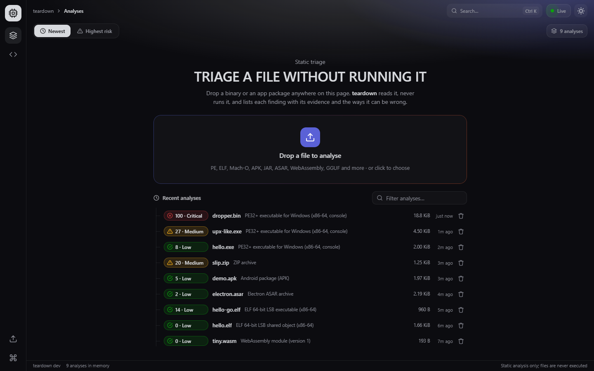
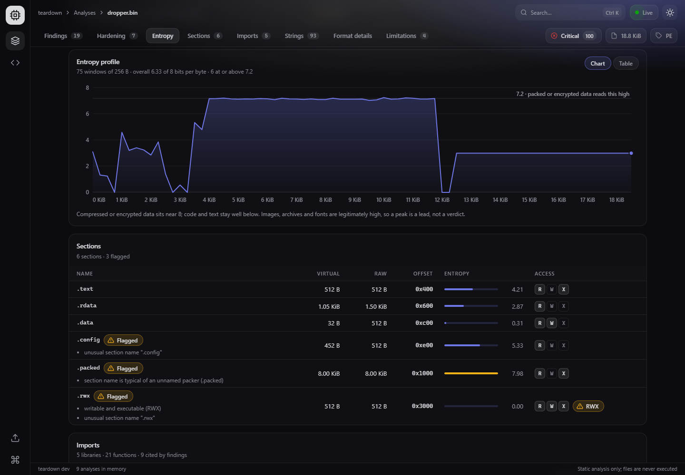
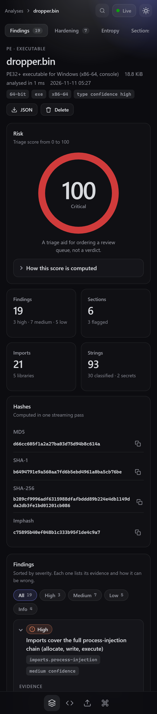
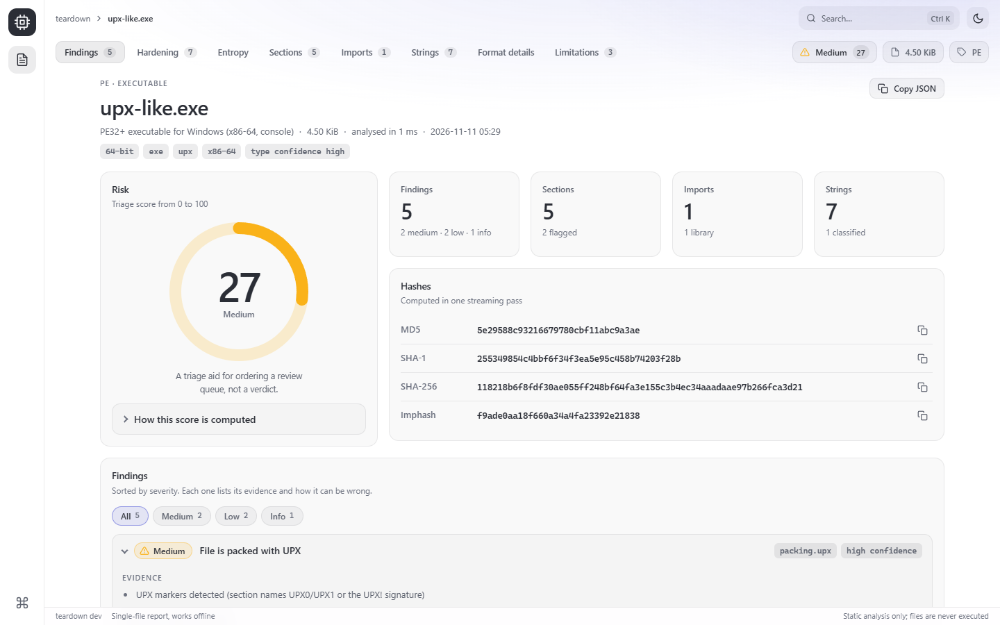
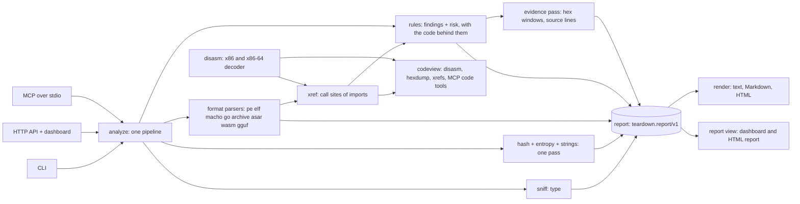

<p align="center">
  
</p>

**Point it at a file, learn what it is and what deserves a second look. Every conclusion comes with its evidence and the reasons it may be wrong, and the file is never executed.** Where a finding is about code, it shows the code: the instructions around a call, the bytes around a string, the source lines of a script. One Go binary, standard library only: a CLI, an HTTP API with a live dashboard, and an MCP server for AI agents.

[](go.mod)
[](LICENSE)
[](go.mod)
[](https://github.com/q6r/teardown/actions/workflows/ci.yml)

English · [Português](README.pt-BR.md)

<p align="center">
  
</p>
<p align="center"><sub>The dashboard report for <code>dropper.bin</code>, a harmless synthetic file that only looks like a dropper to a static scanner (<code>go run ./examples/gensamples -dropper</code>).</sub></p>

## Why

- **Evidence, not verdicts.** A finding is `{id, title, severity, evidence[], limitations[]}` plus, when it is about code, the `code[]` behind it, and a test fails when one lacks evidence or limitations. The 0-100 risk score prints its own arithmetic. It orders a review queue; it does not call anything malware.
- **Safe to point at hostile files.** Nothing is loaded, run, evaluated or unpacked beyond small capped metadata. Parsers are bounded, cancellable and panic-safe, and fuzzed. Uploads live in a private directory and are deleted as soon as the analysis ends.
- **One binary, four ways in.** Terminal report, JSON for CI, a dashboard and a self-contained HTML report for people, MCP tools for agents. They all call the same engine, so they cannot disagree.

## Features

- **Formats.** PE (EXE, DLL, drivers, .NET, import hash), ELF with built-in checksec-style hardening, Mach-O including fat binaries, Go build information, the ZIP family detected by content (JAR, APK, AAB, Office, ODF, EPUB, NuGet, wheel, VSIX) with zip-slip and zip-bomb heuristics, Electron ASAR with risky-setting hints, WebAssembly and GGUF models. Other types (PDF, SQLite, safetensors, images, compression formats, scripts) are recognised and get the generic analysis; the report says no format-specific parser exists.
- **One streaming pass** for MD5, SHA-1, SHA-256, Shannon entropy (overall and in up to 512 windows) and string extraction (ASCII and UTF-16LE).
- **Strings that mean something.** Classified into URLs, domains, IPs, e-mail, paths, registry keys, commands, user agents, API names, base64 and hex. Secrets (AWS keys, GitHub and Slack tokens, PEM keys, JWTs) are redacted in every output: four characters and the length, never the value.
- **Findings with a documented score.** Packing, RWX sections, missing hardening, suspicious import clusters, embedded indicators, zip-slip, risky Electron and Android settings, privacy leaks such as PDB paths. [Catalogue and score](docs/rules.md).
- **Code evidence.** The call sites of suspicious imports in PE images with the instructions around each call, a hex window around the strings behind a finding (secrets masked byte for byte), the source lines of Electron settings and of strings in ASAR archives and stored ZIP entries. A small built-in x86 and x86-64 decoder, checked against the Go toolchain's own disassembler; no decompiler, no emulator. [How it works and what it does not show](docs/code-evidence.md).
- **CLI** with `analyze`, `strings`, `hash`, `diff`, `disasm`, `xrefs`, `hexdump`, `serve`, `mcp`, `completion`; human, JSON, Markdown, SARIF and HTML output; `--fail-on` as a CI gate; colour that respects `NO_COLOR`.
- **Dashboard** at `teardown serve`: drop a file anywhere on the page, watch analyses from other clients arrive live, read the report with charts, tables and a Code panel in each finding, `Ctrl+K` to jump anywhere, light and dark themes, keyboard friendly, works offline.
- **HTML report** with `analyze --html`: the same report view as one self-contained file that opens from disk, offline, and cannot make a network request.
- **MCP server** with eight tools (`analyze_file`, `list_strings`, `hash_file`, `entropy_profile`, `diff_files`, `disassemble`, `find_calls`, `read_bytes`), confined to the directories you allow.

## Quick start

Every tagged version has ready-made archives for Linux, macOS and Windows (amd64 and arm64) on the
[Releases page](https://github.com/q6r/teardown/releases), with a `checksums.txt` to verify them. To build from source instead,
you need Go 1.24 or newer and nothing else. Clone the repository, then build:

```bash
go build -o bin/teardown ./cmd/teardown        # on Windows the binary is bin\teardown.exe
./bin/teardown analyze examples/samples/upx-like.exe
```

The samples in `examples/samples/` are tiny, harmless files generated by this repository's own fixture builders (`go run ./examples/gensamples`). One more is generated on demand, because antivirus products may flag a file that imports process-injection functions: `go run ./examples/gensamples -dropper` writes `examples/samples/dropper.bin`, a PE whose imports cover the process-injection chain and whose code calls them the way compilers do (its entry point just returns, and it is not meant to be run). The code-evidence examples below use it. Then start the dashboard and fill it with the samples:

```bash
./bin/teardown serve                  # http://127.0.0.1:7777, keep it running
bash examples/upload-samples.sh       # in a second terminal. PowerShell: .\examples\upload-samples.ps1
```

## Usage

### Analyse a file

<p align="center">
  
</p>

The same report as plain text, which is what you get in a pipe, in a CI log or with `--color never`:

```console
$ teardown analyze examples/samples/upx-like.exe
teardown  dev · static triage, the file was never executed

upx-like.exe
PE32+ executable for Windows (x86-64, console)  [64-bit, exe, upx, x86-64]
4.5 KiB (4,608 bytes) · type confidence high · analysed in 4 ms

RISK  ██████░░░░░░░░░░░░░░░░░░  27/100  MEDIUM
a triage aid for ordering a review queue, not a verdict

── Hashes
  md5      5e29588c93216679780cbf11abc9a3ae
  sha1     255349854c4bbf6f34f3ea5e95c458b74203f28b
  sha256   118218b6f8fdf30ae055ff248bf64fa3e155c3b4ec34aaadaae97b266fca3d21
  imphash  f9ade0aa18f660a34a4fa23392e21838

── Entropy  1.01 of 8.00 bits per byte
  ████░░░░░░░░░░░░░░░░░░░░░░░░░░░░  1.01
  ▄▂▂▁▁▁▂▁▁▁▁▁▁▁▁▁▁▁
  18 windows of 256 B; high bars suggest compressed or encrypted data

── Sections (5)
  name        virtual        raw  entropy           flags
  .text         512 B      512 B  ░░░░░░░░ 0.06     R-X
  .rdata        120 B      512 B  █░░░░░░░ 0.62     R--
  .data          32 B      512 B  ░░░░░░░░ 0.31     RW-
  UPX0      128.0 KiB        0 B  ░░░░░░░░ 0.00     RWX  writable and executable (RWX); section na…
  UPX1        2.0 KiB    2.0 KiB  ░░░░░░░░ 0.00     R-X  section name is typical of UPX

── Findings (5)
  [MEDIUM]   packing.upx  confidence high
      File is packed with UPX
      evidence: UPX markers detected (section names UPX0/UPX1 or the UPX! signature)
      limitation: UPX is a legitimate open-source packer that benign software also uses to shrink
                  binaries.
  [MEDIUM]   structure.rwx-section  confidence high
      Section is both writable and executable
      evidence: UPX0: flags RWX, raw size 0 B
      limitation: Describes the file layout, not run-time behaviour. Packers, self-extractors,
                  JIT-style loaders and some legacy toolchains legitimately use RWX sections.
  …
```

The output above is trimmed (hardening, imports, strings, three more findings and the limitations are cut). `-v` adds the risk arithmetic and every piece of evidence. `--json` prints the whole report as [`teardown.report/v1`](docs/api/schema.md), `--md` prints Markdown, `--sarif` prints SARIF, `--html` writes a single-file report (below):

```console
$ teardown analyze examples/samples/upx-like.exe --json
{
  "schema": "teardown.report/v1",
  "tool": { "name": "teardown", "version": "dev" },
  "file": { "name": "upx-like.exe", "size": 4608 },
  "type": { "id": "pe", "family": "executable", "label": "PE32+ executable for Windows (x86-64, console)", "confidence": "high", "tags": ["64-bit", "exe", "upx", "x86-64"] },
  "hashes": { "md5": "5e29588c93216679780cbf11abc9a3ae", "sha256": "118218b6f8fdf30a…" },
  "risk": { "score": 27, "label": "medium", "basis": [ … ] },
  "findings": [ { "id": "packing.upx", "severity": "medium", "category": "packing", "evidence": [ … ], "limitations": [ … ] }, … ],
  …
}
```

(Trimmed and re-indented here; the real output is longer and indented by line.) Every key is documented in the [schema reference](docs/api/schema.md).

### Code evidence

<p align="center">
  
</p>

A finding that is about code shows the code. This is the process-injection finding of the demo file, which is generated on demand (`go run ./examples/gensamples -dropper`; it is harmless, and it is not committed because antivirus products may flag a file that imports these functions). Rows are cut where a line says `…`:

```console
$ teardown analyze examples/samples/dropper.bin
…
── Findings (19)
  [HIGH]     imports.process-injection  confidence medium
      Imports cover the full process-injection chain (allocate, write, execute)
      evidence: allocate or map memory in another process: KERNEL32.dll!VirtualAllocEx
      evidence: write to another process: KERNEL32.dll!WriteProcessMemory
      evidence: start or hijack a thread there: KERNEL32.dll!CreateRemoteThread
      (+2 more evidence lines, see -v)
      code: 4 blocks
        call to KERNEL32.dll!VirtualAllocEx in .text  (.text · 0x1400010bd · x86-64)
            0x1400010bd  41 b8 a4 01 00 00        mov r8d, 0x1a4
            0x1400010c3  ff 15 ef 10 00 00        call qword ptr [rip+0x10ef]  ; KERNEL32.dll!OpenProcess
            …
            0x1400010d5  41 b8 00 10 00 00        mov r8d, 0x1000
            0x1400010db  41 b9 00 30 00 00        mov r9d, 0x3000
            0x1400010e1  c7 44 24 20 40 00 00 00  mov dword ptr [rsp+0x20], 0x40
          > 0x1400010e9  ff 15 b1 10 00 00        call qword ptr [rip+0x10b1]  ; KERNEL32.dll!VirtualAllocEx
            0x1400010ef  48 89 44 24 50           mov qword ptr [rsp+0x50], rax
            …
        call to KERNEL32.dll!WriteProcessMemory in .text  (.text · 0x1400010e1 · x86-64)
            …
        (+1 more code block, see --code-all or --json)
        limits: x86-64 code decoded as a linear sweep (ARM64 and other instruction sets
                are not supported): data inside a code section can be read as
                instructions, and one wrong byte shifts what follows.
```

The `>` marks the call the finding is about, and the lines above it show how its arguments are set up. teardown does not interpret them: read against the Windows x64 calling convention (arguments in `rcx`, `rdx`, `r8`, `r9`, then on the stack), these lines ask another process for a 4 KiB allocation of type `0x3000` (commit and reserve) with protection `0x40` (read, write and execute), a detail an import list cannot show. The same code is one command away, for any import, address or offset:

```console
$ teardown xrefs examples/samples/dropper.bin VirtualAllocEx --before 3 --after 2
dropper.bin: KERNEL32.dll!VirtualAllocEx
1 call site (PE x86-64, linear sweep of the executable sections)

  #1  call [IAT]  0x1400010e9  (file offset 0x4e9, section .text)
      0x1400010d5  41 b8 00 10 00 00        mov r8d, 0x1000
      0x1400010db  41 b9 00 30 00 00        mov r9d, 0x3000
      0x1400010e1  c7 44 24 20 40 00 00 00  mov dword ptr [rsp+0x20], 0x40
    > 0x1400010e9  ff 15 b1 10 00 00        call qword ptr [rip+0x10b1]  ; KERNEL32.dll!VirtualAllocEx
      0x1400010ef  48 89 44 24 50           mov qword ptr [rsp+0x50], rax
      0x1400010f4  48 8b 4c 24 48           mov rcx, qword ptr [rsp+0x48]

  limits: x86-64 code decoded as a linear sweep (ARM64 and other instruction sets are not
          supported): data inside a code section can be read as instructions, and one wrong byte
          shifts what follows.
  limits: Only calls through the import table and import thunks are found: functions resolved at run
          time are invisible, and packed or protected code hides its real calls.
  limits: A view of the code, not a decompiler, an emulator or a verdict: nothing was executed, and
          the code shows what is called, not why.

$ teardown disasm examples/samples/dropper.bin --at 0x1400010e9 -n 3
; dropper.bin: PE, x86-64, section .text, 3 instructions from 0x1400010e9 (file offset 0x4e9)
; Linear sweep: the bytes are decoded one after another, so data can be shown as code and the sweep can lose sync.
; x86 and x86-64 only; bytes that are not understood are shown as db. Not a decompiler: nothing is executed, emulated or resolved.
0x1400010e9  ff 15 b1 10 00 00  call qword ptr [rip+0x10b1]  ; KERNEL32.dll!VirtualAllocEx
0x1400010ef  48 89 44 24 50     mov qword ptr [rsp+0x50], rax
0x1400010f4  48 8b 4c 24 48     mov rcx, qword ptr [rsp+0x48]
; more code follows: continue with --at 0x1400010f9

$ teardown hexdump examples/samples/dropper.bin --at 0x4e9 -n 16
00000004e9  ff 15 b1 10 00 00 48 89 44 24 50 48 8b 4c 24 48  |......H.D$PH.L$H|
16 bytes shown (file offsets 0x4e9 to 0x4f8 of 19200); continue with --at 0x4f9
```

`xrefs` answers "who calls this import" (`--list` shows every import that is called), `disasm` decodes from an address, a file offset or the entry point, and `hexdump` shows raw bytes; each takes `--json`, and each is bounded ([commands](docs/cli.md#disasm)). The same blocks are in `findings[].code` of the JSON report (`analyze --json`, the HTTP API and the `analyze_file` MCP tool), in the Markdown, SARIF and HTML reports and in a Code panel inside each finding of the dashboard; `analyze --no-code` leaves them out and `--code-all` prints every block.

What it shows:

- **Call sites of imports**, for the findings made from imports (process injection, keylogging, anti-debug, crypto, networking, download and execute, services, token privileges): up to 6 per function, with 8 instructions before the call and 4 after, in PE images for x86-64 and x86.
- **Hex windows** around the strings behind `secrets.*`, `indicators.network`, `indicators.suspicious-commands` and `indicators.persistence-registry`. Secrets stay redacted here too: every byte of a credential is shown as `2a` and `*`.
- **Source lines** with line numbers and three lines of context for the strings and the Electron settings that sit in text entries of ASAR archives, in stored ZIP entries and in text files.

What it does not do: decompile, emulate, unpack or run anything; read ARM64 or other non-x86 code; find call sites in ELF (PLT and GOT, which is next) or Mach-O files; see imports that a program resolves at run time; show the text of deflated ZIP entries (no rule scans them, so only stored entries and ASAR entries give source lines). It is a linear sweep, so data can be shown as code and the sweep can lose its place; every block says so in its limitations, never changes a severity or the score, and does not call anything malicious. 32-bit PE images are handled but tested only with a hand-made image.

The decoder is checked against the Go toolchain's own disassembler (`go tool objdump`): over `cmd/gofmt` and `cmd/go` built for Windows on amd64 and 386 it was compared on 4,318,469 instructions, agreed on the length of every one and fell back to `db` for none. The instructions the Go toolchain itself cannot decode are left out of that figure, and it covers the code the Go compiler emits and nothing else. How to run the comparison, the numbers and the caveats: [docs/code-evidence.md](docs/code-evidence.md#how-it-was-checked).

### Gate a build in CI

`--fail-on <severity>` exits with status 3 when a finding at or above that severity exists:

```console
$ teardown analyze examples/samples/upx-like.exe --fail-on high > /dev/null; echo $?
0
$ teardown analyze examples/samples/upx-like.exe --fail-on medium > /dev/null; echo $?
teardown analyze: --fail-on medium: 2 finding(s) at or above medium: packing.upx (medium), structure.rwx-section (medium)
3
```

Exit codes: `0` success, `1` error, `2` usage error, `3` threshold reached. Ready-made wrappers: [`examples/ci-gate.sh`](examples/ci-gate.sh) and [`examples/ci-gate.ps1`](examples/ci-gate.ps1). For code-scanning dashboards, `teardown analyze app.exe --sarif -o app.sarif` writes the findings as SARIF 2.1.0 ([details](docs/cli.md#sarif)).

### Compare two files

```console
$ teardown diff examples/samples/hello.exe examples/samples/upx-like.exe
teardown diff

a  hello.exe  2.0 KiB · PE32+ executable for Windows (x86-64, console) · risk 8
   sha256 6d3bd25d10c80d4c64ea8419f1bcf82dec72c8ea6c71cfe3be33a1a29d2f9fa5
b  upx-like.exe  4.5 KiB · PE32+ executable for Windows (x86-64, console) · risk 27
   sha256 118218b6f8fdf30ae055ff248bf64fa3e155c3b4ec34aaadaae97b266fca3d21

── Summary
  · SHA-256 differs
  · size 2048 -> 4608 bytes (+2560)
  · tags added: upx
  · import hash changed: the import table differs
  · 2 section(s) added: UPX0, UPX1
  · section .rdata entropy 2.33 -> 0.62
  · imports: +0 -3 functions
  · strings: +1 new, -5 gone
  · new finding packing.upx (medium)
  · new finding structure.rwx-section (medium)
  · new finding structure.suspicious-section (low)
  · finding gone privacy.pdb-path (low)
  · risk 8 (low) -> 27 (medium), +19
  …
```

(The output goes on with the added sections, the findings that appeared or disappeared, and the removed imports and new strings.)

`strings`, `hash`, `serve`, `mcp` and `completion` are covered in the [command reference](docs/cli.md).

### HTTP API

`teardown serve` serves the dashboard and a JSON API on `127.0.0.1:7777`. Reports are kept in memory only.

```console
$ curl -s -F file=@examples/samples/upx-like.exe http://127.0.0.1:7777/api/analyze
{"id":"an_afe16d7c12bb","report":{"schema":"teardown.report/v1","tool":{"name":"teardown","version":"dev"},"generatedAt":"2026-11-11T01:10:05.945Z","durationMs":1,"file":{"name":"upx-like.exe","size":4608},"type":{"id":"pe", …

$ curl -s http://127.0.0.1:7777/api/analyses
[{"id":"an_a4ebc5ea28de","name":"demo.apk","size":2018,"type":"apk","typeLabel":"Android package (APK)","risk":{"score":5,"label":"low"},"createdAt":"2026-11-11T01:10:06.004Z"}, …]

$ curl -s "http://127.0.0.1:7777/api/analyses/an_afe16d7c12bb/strings?category=api,plain&q=exit&limit=5"
{"total":1,"offset":0,"limit":5,"items":[{"value":"ExitProcess","offset":1594,"encoding":"ascii","category":"api","redacted":false,"kind":"system"}]}
```

`GET /api/events` is a server-sent event stream that announces every analysis, including those made by other clients:

```console
$ curl -sN http://127.0.0.1:7777/api/events
: stream open

event: analysis.started
data: {"id":"an_70a2454cafb6","name":"hello.exe","size":2048}

event: analysis.completed
data: {"id":"an_70a2454cafb6","name":"hello.exe","size":2048,"type":"pe","typeLabel":"PE32+ executable for Windows (x86-64, console)","risk":{"score":8,"label":"low"},"createdAt":"2026-11-11T01:10:07.473Z","durationMs":1}
```

In Windows PowerShell type `curl.exe`, because `curl` is an alias for `Invoke-WebRequest`. Routes, errors, limits and the security model: [docs/api/http.md](docs/api/http.md); machine-readable: `GET /api/openapi.json` (OpenAPI 3.1).

### Dashboard

`teardown serve` serves the dashboard at `http://127.0.0.1:7777`. It talks only to the documented HTTP API, loads nothing from the network and runs under the server's strict Content-Security-Policy. The page is the Aurora layout: a navigation rail on the left, a top bar with the breadcrumbs, the search button and the live indicator, a sub bar with the view switch and the tab pills, flat cards under a soft glow and a thin status bar, in the Prism Classic palette (Prism Daylight in the light theme).

<p align="center">
  
</p>

- **Home.** Drop a file anywhere on the page, click the drop zone, or press `Ctrl+K` and choose Upload. Each upload shows its progress. Below the drop zone the list shows the recent analyses (risk, name, type, size, age, delete with confirmation). Filter it by name or type, order it by age or by risk with the switch in the sub bar, and watch it update live: a `curl` upload from another terminal appears without a reload, first as "Analysing" and then with its risk.
- **Report** at `#/analysis/<id>`. The page header with the file name, type, tags and the JSON and Delete buttons; the risk ring and how the score is computed; tiles and hashes with copy buttons; findings sorted by severity with a severity filter, their evidence, the code behind them in a Code panel (monospace tables of address, bytes and instruction, the flagged line marked, a Copy button, a notice when a block is only a window) and limitations; the hardening checklist; the entropy profile with the packing threshold; sections with entropy bars and access flags; imports as an accordion per library (functions that findings cite are highlighted); strings by category with search and filters (secrets stay redacted); format details and limitations. The tab pills in the sub bar take you to a section, show how many items it has and follow the scroll, and the pills at the right of the bar carry the risk, the size and the type. Every chart has a Chart/Table toggle.
- **Command palette.** `Ctrl+K` opens a recent analysis, jumps to a part of a report, copies a hash, uploads a file or switches the theme.

<p align="center">
  
</p>

The layout was checked at 360, 768, 1440 and 1920 px wide, in the dark and the light theme, with reduced motion, and with the keyboard.

<p align="center">
  
</p>

### Single-file HTML report

```console
$ teardown analyze examples/samples/upx-like.exe --html report.html
wrote report.html (risk 27/100 medium, 5 findings)
```

`report.html` (about 260 KB) is the dashboard's report page in one file, with the same rail, bars and tab pills (here plain `#fragment` links): styles, scripts and the report itself are inlined, so it opens from disk, offline, and can be attached to a ticket or an e-mail.

<p align="center">
  
</p>

- The report sits in an inert JSON island in which `<`, `>`, `&`, U+2028, U+2029 and invisible format characters are escaped, so a hostile file name or string cannot close it; the view renders everything as text.
- A Content-Security-Policy `<meta>` tag allows only the page's own script and style (by hash) and `data:` images, so even a bug in the page could not make a network request.
- With scripting off, `<noscript>` shows a plain readable summary. Tests cover all three.

### MCP for AI agents

`teardown mcp` speaks the Model Context Protocol over stdio. Files can be read only below the `--root` directories; symlinks that escape, directories and devices are refused.

| Tool | What it returns |
|---|---|
| `analyze_file` | The report (type, hashes, entropy, sections, imports, hardening, findings, risk), with a `detail` level |
| `list_strings` | Classified strings with offsets, filterable by category and text, paged |
| `hash_file` | MD5, SHA-1, SHA-256 and the PE import hash |
| `entropy_profile` | Overall entropy plus up to 512 windows |
| `diff_files` | What changed between two files |
| `disassemble` | x86 and x86-64 instructions at an address, a file offset or the entry point, as a code block |
| `find_calls` | The call sites of an imported function in a PE image, each with the instructions around it |
| `read_bytes` | A hex and ASCII window of the raw bytes of a file, as a code block |

A real exchange, fed from [`examples/mcp-session.jsonl`](examples/mcp-session.jsonl) (responses shortened; the paths in messages are elided):

```console
$ teardown mcp --root examples/samples < examples/mcp-session.jsonl
{"jsonrpc":"2.0","id":1,"result":{"protocolVersion":"2025-06-18","capabilities":{"tools":{"listChanged":false}},"serverInfo":{"name":"teardown","title":"teardown static triage","version":"dev"}, …}}
{"jsonrpc":"2.0","id":2,"result":{"tools":[{"name":"analyze_file", …}, {"name":"list_strings", …}, {"name":"hash_file", …}, {"name":"entropy_profile", …}, {"name":"diff_files", …}, {"name":"disassemble", …}, {"name":"find_calls", …}, {"name":"read_bytes", …}]}}
{"jsonrpc":"2.0","id":5,"result":{"content":[{"type":"text","text":"path \"../etc/passwd\" is outside the allowed roots; only files inside … can be analysed"}],"isError":true}}
…
```

An agent that reads a finding can follow it to the code. With the demo file of the previous section in `examples/samples/`, one request asks who calls `VirtualAllocEx` (the server answers a request without the handshake; in PowerShell quote the JSON with single quotes and write `examples\samples`):

```console
$ echo '{"jsonrpc":"2.0","id":1,"method":"tools/call","params":{"name":"find_calls","arguments":{"path":"dropper.bin","api":"VirtualAllocEx","before":3,"after":2}}}' | teardown mcp --root examples/samples
{"jsonrpc":"2.0","id":1,"result":{"content":[{"type":"text","text":"{\n  \"file\": {\n    \"name\": \"dropper.bin\",\n    \"size\": 19200\n  },\n  \"api\": \"VirtualAllocEx\",\n  \"imports\": [\"KERNEL32.dll!VirtualAllocEx\"],\n  \"arch\": \"x86-64\",\n  \"total\": 1,\n  \"sites\": [\n    {\n      \"api\": \"KERNEL32.dll!VirtualAllocEx\",\n      \"kind\": \"call\",\n      \"address\": \"0x1400010e9\",\n      \"offset\": 1257,\n      \"section\": \".text\",\n      \"code\": {\n        \"kind\": \"disasm\",\n        \"title\": \"call to KERNEL32.dll!VirtualAllocEx in .text\", …
```

The text of the answer is the same code block the report carries: the six instructions around the call at `0x1400010e9`, the call flagged and named in a `note`, and the limitations of the view. [`read_bytes`](docs/mcp.md#read_bytes) and [`disassemble`](docs/mcp.md#disassemble) read any offset or address, and every code tool keeps to the `--root` directories. Setup for Claude Desktop and Claude Code, the schemas and the full transcript are in the [MCP guide](docs/mcp.md).

## Architecture



One pipeline produces one data contract, and every surface is a thin shell around the two; the small decoder and its readers feed the findings and the code commands alike. More in [docs/architecture.md](docs/architecture.md).

## Project layout

```text
cmd/teardown/           entry point
internal/analyze/       the pipeline: sniff, one-pass hashing, parser, rules, report
internal/report/        the teardown.report/v1 contract (leaf package)
internal/sniff/         content-type detection by magic bytes and structure
internal/format/*/      one parser per format: pe elf macho goinfo archive asar wasm gguf
internal/disasm/        the x86 and x86-64 decoder, with its fuzz target and the developer oracles
internal/hexdump/       bounded hex and ASCII windows
internal/xref/          call sites of the imports of a PE image, with the code around each
internal/codeview/      windows at an address or an offset: the engine of disasm, hexdump and the MCP code tools
internal/rules/         findings engine and risk score (docs/rules.md is generated from it)
internal/render/        terminal, Markdown and HTML output
internal/server/        HTTP API, security middleware, server-sent events, OpenAPI document
internal/mcp/           MCP server over stdio
internal/cli/           subcommands, flags, completion
web/                    the dashboard and the Aurora UI kit (embedded with go:embed), the shared report view
docs/                   architecture, command reference, code evidence, HTTP API, schema, rules, MCP guide
examples/               generated samples, CI gate scripts, upload scripts, an MCP session
testdata/               golden sample report
```

## Configuration

| Setting | Where | Default | Meaning |
|---|---|---|---|
| `--addr` | `serve` | `127.0.0.1:7777` | Listen address; anything but loopback prints a warning |
| `--max-upload` | `serve` | `256MiB` | Largest accepted upload |
| `--keep` | `serve` | `50` | Analyses kept in memory, oldest dropped first (at most 10000) |
| `--root` | `mcp` | current directory | Directory files may be read from; repeatable |
| `--min-string` | `analyze` | `5` | Minimum string length |
| `--max-strings` | `analyze` | `2000` | String items kept in the report |
| `--timeout` | `analyze` | `1m` | Give up after this long |
| `--no-code`, `--code-all` | `analyze` | off | Leave the code behind the findings out of every output, or print every block of each finding in full (the terminal shows 3 blocks of 24 lines by default) |
| `--at`, `--offset`, `-n` / `--count`, `--length`, `--arch` | `disasm`, `hexdump` | entry point, 24 instructions, 128 bytes | Where and how much to show; at most 256 instructions or 4096 bytes |
| `--before`, `--after`, `--max`, `--list` | `xrefs` | 8, 4, 10 | Instructions around each call (at most 40 and 20), call sites to show (at most 100), or the list of called imports |
| `--color`, `--ascii`, `--width` | `analyze`, `strings`, `hash`, `diff` | `auto` | Terminal output |
| `NO_COLOR` | environment | unset | Any non-empty value disables colour |
| `TEARDOWN_ASCII` | environment | unset | Any non-empty value switches to ASCII bars |

## Security notes

- **The target is never executed**, loaded, evaluated or decompressed beyond small capped metadata entries. The decoder turns bytes into text and does nothing else with them.
- **Bounded everywhere.** Every count, offset and size read from a file is checked against the file size before any allocation, every list is capped, every long loop honours the context, and one analysis has a 60 second deadline. A parser crash becomes a finding and the rest of the report survives. The decoder never panics or reads past its input (it is fuzzed), the scan for call sites has byte, instruction and site limits and says when it reached one, and a finding carries at most 12 code blocks of 64 lines.
- **The server is for you, on your machine.** It binds to loopback by default and answers only loopback `Host` headers (DNS-rebinding defence), refuses cross-origin `POST` and `DELETE`, sends no CORS headers and a strict Content-Security-Policy. Uploads are streamed into a private directory under random names, size-capped to the byte, and deleted right after analysis. It has no authentication and no TLS: do not expose it to a network you do not trust. [Details](docs/api/http.md#security-model).
- **MCP is confined.** Files open through `os.Root` below the allowed directories only; escaping symlinks, directories and devices are refused.
- **Secrets stay redacted** in every output: terminal, JSON, Markdown, the API, MCP and the HTML report, and in the hex windows behind a finding, where every byte of a credential is masked.
- **Reports are safe to open.** Text from the analysed file is rendered as text, never as markup. The HTML report is a single offline file with a Content-Security-Policy that allows no network access, and its embedded JSON cannot be closed by hostile names or strings.
- No telemetry, no runtime network access, no third-party modules.

Vulnerabilities: see [SECURITY.md](SECURITY.md).

### Limitations

teardown is a first look, not a sandbox or an antivirus. It does not decompile, emulate or unpack. Its small decoder reads x86 and x86-64 code only (ARM64 comes later), as a linear sweep that can show data as code and lose its place, and it finds the call sites of imports in PE images only (ELF and Mach-O are next). Packers and protectors hide code and imports from static analysis; imports resolved at run time are invisible. Findings are heuristics: each lists how it can be a false positive. Authenticode and code signatures are detected, not verified. Android permissions are read from the manifest heuristically. PDF, SQLite, safetensors, images and compression formats are recognised but not parsed. Reports live in memory and disappear when the server stops.

## Testing

```bash
go test ./...                   # offline, well under a minute
go test -race -p 1 ./...        # race detector, one package at a time (needs cgo; CI runs it on Linux, macOS and Windows; several minutes)
make fuzz FUZZTIME=20s          # every native fuzz target, 20 s each
```

782 test functions (about 4,500 cases with their subtests and fuzz seeds) in 31 packages, plus 31 fuzz targets. The decoder has table-driven tests with hand-checked encodings, a fuzz target and two developer tests that compare it with the Go toolchain's disassembler (they run only on request, see [docs/code-evidence.md](docs/code-evidence.md#how-it-was-checked)); the call-site engine is tested on fixtures that contain real code. The suite generates its own fixtures in code (no third-party binaries), runs a "never panics" sweep over every parser (every prefix length, corrupted bytes), fuzzes the sniffer and each parser, tests the HTTP layer with `httptest` and MCP over in-memory pipes (including root-escape and symlink attempts), pins the report contract with a golden file, and checks the dashboard assets and the HTML report (hostile file names and strings, U+2028, Content-Security-Policy hashes, no external URLs, size).

## Roadmap

**New in 0.2.0: code evidence.** teardown shows the code behind its findings, for developers ([how it works](docs/code-evidence.md)):

- a small x86 and x86-64 decoder, checked against the Go toolchain's own disassembler;
- the call sites of the imports behind a finding, with the instructions around each call, in PE images for x86-64 (32-bit PE images are handled but tested only with a hand-made image), for example where `VirtualAllocEx`, `WriteProcessMemory` and `CreateRemoteThread` are called;
- a hex dump around the strings behind a finding, with secrets masked byte for byte;
- the matching source lines for Electron findings and for strings in ASAR archives and stored ZIP entries (deflated ZIP entries are not scanned);
- all of it through the commands `hexdump`, `disasm` and `xrefs`, the report (JSON, Markdown, SARIF, HTML), the dashboard and the MCP tools `read_bytes`, `disassemble` and `find_calls`.

It is not a decompiler, an emulator or an unpacker, and it reads x86 and x86-64 only.

What comes next, in rough order, not promises and without dates:

- Call sites for ELF executables (PLT and GOT), then for Mach-O.
- Decoding ARM64 code.

Other ideas, in the same spirit:

- Parsers for safetensors, SQLite and PDF structure; .NET metadata and Java class details.
- Verifying Authenticode and macOS code signatures instead of only detecting them.
- A persistent store for the server (today it is memory only) and a diff view in the dashboard.

## Contributing

Small and dependency-free is the point. Read [CONTRIBUTING.md](CONTRIBUTING.md) for setup, the checks to run and how to add a parser or a rule. Commits follow [Conventional Commits](https://www.conventionalcommits.org/).

## License

[MIT](LICENSE) © 2026 q6r.

## Credits

teardown is inspired by [REA](https://github.com/morluto/rea), which showed how useful findings that carry evidence and limitations are when an AI agent can ask for them over MCP. teardown is an independent, clean-room project: not affiliated with or derived from REA, and much narrower in scope (static triage, with a small x86 decoder for code evidence and no decompiler). The comparison is in [docs/inspired-by-rea.md](docs/inspired-by-rea.md). The dashboard is built on the Aurora UI kit (one stylesheet and two scripts: zero dependencies, MIT, part of this repository in `web/`).
