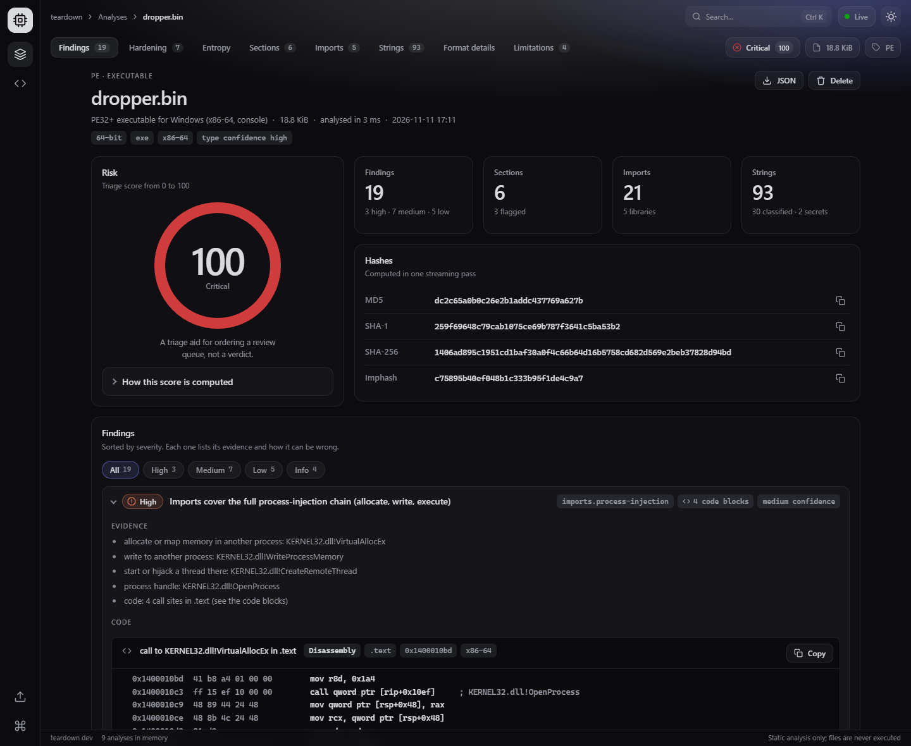
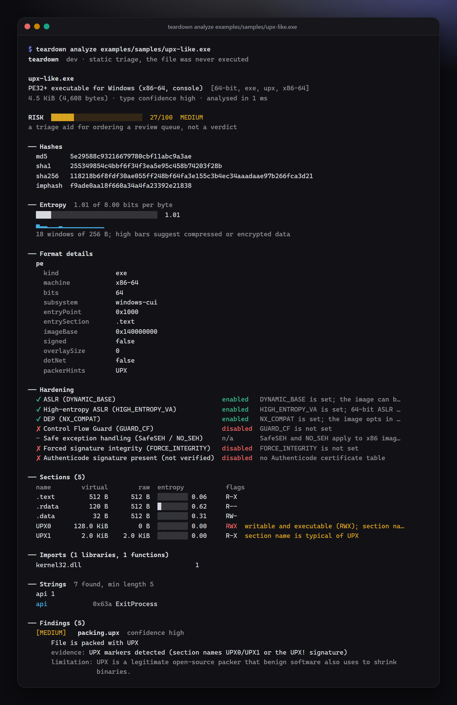
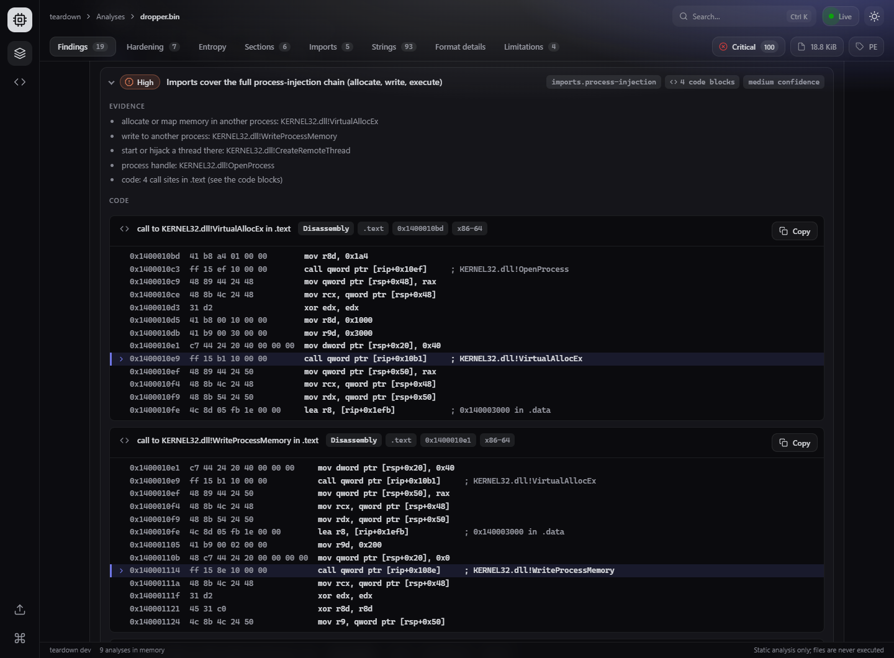
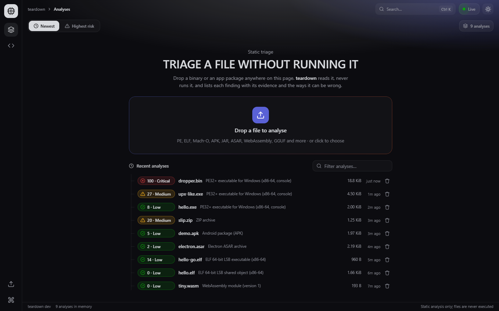
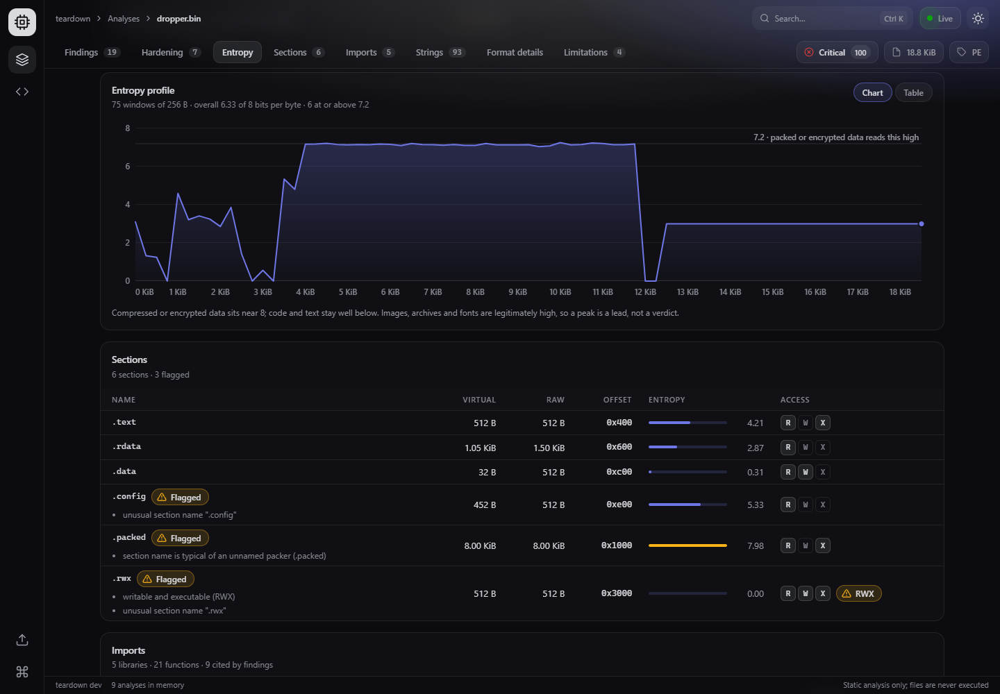
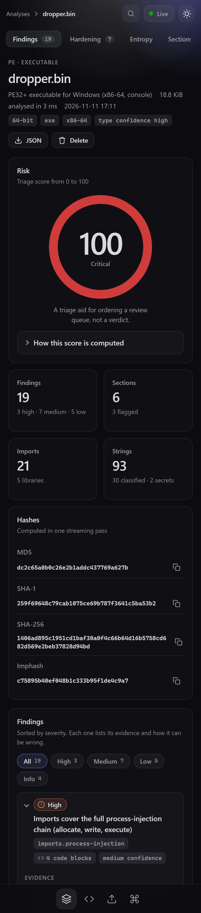
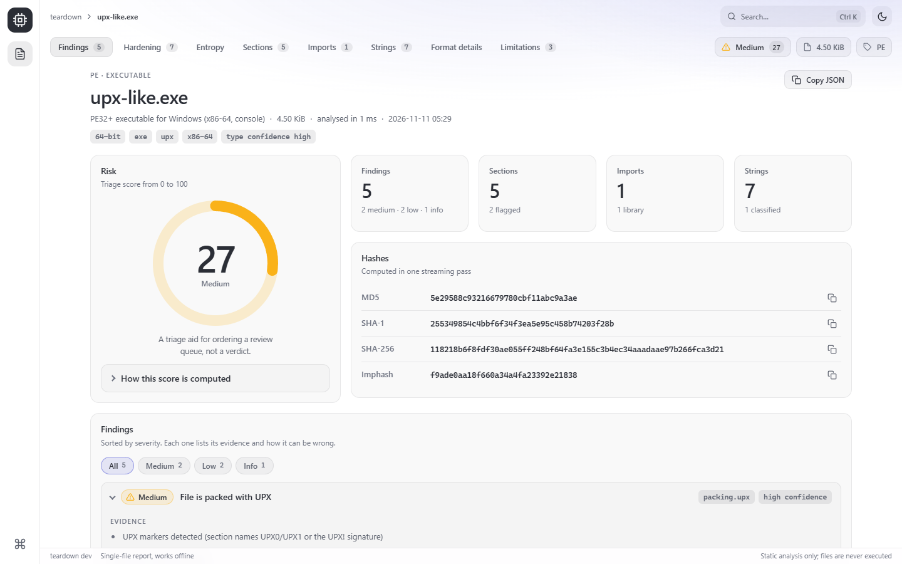
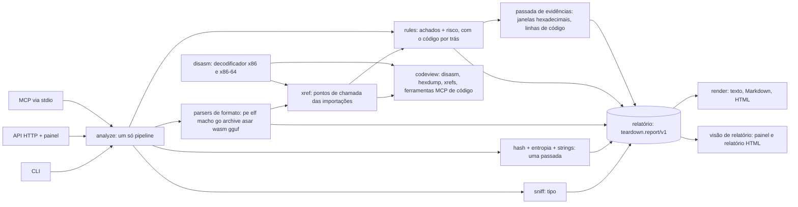

<p align="center">
  
</p>

**Aponte para um arquivo e descubra o que ele é e o que merece uma segunda olhada. Cada conclusão vem com a evidência e com os motivos pelos quais pode estar errada, e o arquivo nunca é executado.** Quando um achado é sobre código, ele mostra o código: as instruções em volta de uma chamada, os bytes em volta de uma string, as linhas de um script. Um único binário em Go, só com a biblioteca padrão: uma CLI, uma API HTTP com painel ao vivo e um servidor MCP para agentes de IA.

[](go.mod)
[](LICENSE)
[](go.mod)
[](https://github.com/q6r/teardown/actions/workflows/ci.yml)

[English](README.md) · Português

<p align="center">
  
</p>
<p align="center"><sub>O relatório do painel para <code>dropper.bin</code>, um arquivo sintético inofensivo que só parece um dropper para um scanner estático (<code>go run ./examples/gensamples -dropper</code>).</sub></p>

## Por quê

- **Evidência, não veredito.** Um achado é `{id, title, severity, evidence[], limitations[]}` e, quando é sobre código, traz também o `code[]` por trás dele, e um teste falha se algum não tiver evidência ou limitações. A pontuação de risco de 0 a 100 mostra a própria conta. Ela ordena uma fila de revisão; não diz que algo é malware.
- **Seguro para apontar contra arquivos hostis.** Nada é carregado, executado, avaliado ou descompactado além de pequenos metadados limitados. Os parsers têm limites, são canceláveis, resistem a pânico e passam por fuzzing. Os envios ficam em um diretório privado e são apagados assim que a análise termina.
- **Um binário, quatro portas de entrada.** Relatório no terminal, JSON para CI, um painel e um relatório HTML autocontido para pessoas, ferramentas MCP para agentes. Todos chamam o mesmo motor, então não têm como discordar entre si.

## Recursos

- **Formatos.** PE (EXE, DLL, drivers, .NET, hash de importação), ELF com verificação de endurecimento no estilo checksec, Mach-O incluindo binários fat, informações de build do Go, a família ZIP detectada pelo conteúdo (JAR, APK, AAB, Office, ODF, EPUB, NuGet, wheel, VSIX) com heurísticas de zip-slip e zip-bomb, ASAR do Electron com indícios de configurações arriscadas, WebAssembly e modelos GGUF. Os outros tipos (PDF, SQLite, safetensors, imagens, formatos de compressão, scripts) são reconhecidos e recebem a análise genérica; o relatório avisa que não existe parser específico para o formato.
- **Uma única passada em streaming** para MD5, SHA-1, SHA-256, entropia de Shannon (total e em até 512 janelas) e extração de strings (ASCII e UTF-16LE).
- **Strings que dizem alguma coisa.** Classificadas em URLs, domínios, IPs, e-mails, caminhos, chaves de registro, comandos, user agents, nomes de API, base64 e hex. Segredos (chaves AWS, tokens do GitHub e do Slack, chaves PEM, JWTs) são ocultados em toda saída: quatro caracteres e o tamanho, nunca o valor.
- **Achados com pontuação documentada.** Empacotamento, seções RWX, endurecimento ausente, grupos suspeitos de importações, indicadores embutidos, zip-slip, configurações arriscadas de Electron e Android, vazamentos de privacidade como caminhos de PDB. [Catálogo e pontuação](docs/rules.md).
- **Código como evidência.** Os pontos de chamada das importações suspeitas em imagens PE, com as instruções em volta de cada chamada, uma janela hexadecimal em volta das strings por trás de um achado (segredos mascarados byte a byte) e as linhas de código das configurações do Electron e das strings em arquivos ASAR e em entradas ZIP armazenadas. Um decodificador x86 e x86-64 pequeno e embutido, conferido contra o disassembler do próprio toolchain do Go; sem decompilador, sem emulador. [Como funciona e o que ele não mostra](docs/code-evidence.md) (em inglês).
- **CLI** com `analyze`, `strings`, `hash`, `diff`, `disasm`, `xrefs`, `hexdump`, `serve`, `mcp`, `completion`; saída humana, JSON, Markdown, SARIF e HTML; `--fail-on` como portão de CI; cores que respeitam `NO_COLOR`.
- **Painel** em `teardown serve`: solte um arquivo em qualquer lugar da página, veja chegar ao vivo as análises feitas por outros clientes, leia o relatório com gráficos, tabelas e um painel de Código em cada achado, `Ctrl+K` para ir a qualquer lugar, temas claro e escuro, boa navegação por teclado, funciona offline.
- **Relatório HTML** com `analyze --html`: a mesma visão de relatório em um único arquivo autocontido, que abre do disco, offline, e não consegue fazer requisições de rede.
- **Servidor MCP** com oito ferramentas (`analyze_file`, `list_strings`, `hash_file`, `entropy_profile`, `diff_files`, `disassemble`, `find_calls`, `read_bytes`), restrito aos diretórios que você permitir.

## Início rápido

Precisa de Go 1.24 ou mais novo e de mais nada. Clone o repositório e compile:

```bash
go build -o bin/teardown ./cmd/teardown        # no Windows o binário é bin\teardown.exe
./bin/teardown analyze examples/samples/upx-like.exe
```

Os exemplos em `examples/samples/` são arquivos minúsculos e inofensivos, gerados pelos construtores de fixtures deste repositório (`go run ./examples/gensamples`). Mais um é gerado sob demanda, porque antivírus podem sinalizar um arquivo que importa funções de injeção de processo: `go run ./examples/gensamples -dropper` grava `examples/samples/dropper.bin`, um PE cujas importações cobrem a cadeia de injeção de processo e cujo código as chama como os compiladores fazem (o ponto de entrada só retorna, e ele não foi feito para ser executado). Os exemplos de código como evidência abaixo usam esse arquivo. Depois suba o painel e encha-o com os exemplos:

```bash
./bin/teardown serve                  # http://127.0.0.1:7777, deixe rodando
bash examples/upload-samples.sh       # em um segundo terminal. PowerShell: .\examples\upload-samples.ps1
```

## Uso

### Analisar um arquivo

<p align="center">
  
</p>

O mesmo relatório em texto simples, que é o que você recebe em um pipe, em um log de CI ou com `--color never`:

```console
$ teardown analyze examples/samples/upx-like.exe
teardown  dev · static triage, the file was never executed

upx-like.exe
PE32+ executable for Windows (x86-64, console)  [64-bit, exe, upx, x86-64]
4.5 KiB (4,608 bytes) · type confidence high · analysed in 4 ms

RISK  ██████░░░░░░░░░░░░░░░░░░  27/100  MEDIUM
a triage aid for ordering a review queue, not a verdict

── Hashes
  md5      5e29588c93216679780cbf11abc9a3ae
  sha1     255349854c4bbf6f34f3ea5e95c458b74203f28b
  sha256   118218b6f8fdf30ae055ff248bf64fa3e155c3b4ec34aaadaae97b266fca3d21
  imphash  f9ade0aa18f660a34a4fa23392e21838

── Entropy  1.01 of 8.00 bits per byte
  ████░░░░░░░░░░░░░░░░░░░░░░░░░░░░  1.01
  ▄▂▂▁▁▁▂▁▁▁▁▁▁▁▁▁▁▁
  18 windows of 256 B; high bars suggest compressed or encrypted data

── Sections (5)
  name        virtual        raw  entropy           flags
  .text         512 B      512 B  ░░░░░░░░ 0.06     R-X
  .rdata        120 B      512 B  █░░░░░░░ 0.62     R--
  .data          32 B      512 B  ░░░░░░░░ 0.31     RW-
  UPX0      128.0 KiB        0 B  ░░░░░░░░ 0.00     RWX  writable and executable (RWX); section na…
  UPX1        2.0 KiB    2.0 KiB  ░░░░░░░░ 0.00     R-X  section name is typical of UPX

── Findings (5)
  [MEDIUM]   packing.upx  confidence high
      File is packed with UPX
      evidence: UPX markers detected (section names UPX0/UPX1 or the UPX! signature)
      limitation: UPX is a legitimate open-source packer that benign software also uses to shrink
                  binaries.
  [MEDIUM]   structure.rwx-section  confidence high
      Section is both writable and executable
      evidence: UPX0: flags RWX, raw size 0 B
      limitation: Describes the file layout, not run-time behaviour. Packers, self-extractors,
                  JIT-style loaders and some legacy toolchains legitimately use RWX sections.
  …
```

A saída acima está cortada (faltam endurecimento, importações, strings, mais três achados e as limitações), e o texto do programa é em inglês. `-v` acrescenta a conta do risco e toda a evidência. `--json` imprime o relatório inteiro como [`teardown.report/v1`](docs/api/schema.md), `--md` imprime Markdown, `--sarif` imprime SARIF e `--html` grava um relatório de arquivo único (abaixo):

```console
$ teardown analyze examples/samples/upx-like.exe --json
{
  "schema": "teardown.report/v1",
  "tool": { "name": "teardown", "version": "dev" },
  "file": { "name": "upx-like.exe", "size": 4608 },
  "type": { "id": "pe", "family": "executable", "label": "PE32+ executable for Windows (x86-64, console)", "confidence": "high", "tags": ["64-bit", "exe", "upx", "x86-64"] },
  "hashes": { "md5": "5e29588c93216679780cbf11abc9a3ae", "sha256": "118218b6f8fdf30a…" },
  "risk": { "score": 27, "label": "medium", "basis": [ … ] },
  "findings": [ { "id": "packing.upx", "severity": "medium", "category": "packing", "evidence": [ … ], "limitations": [ … ] }, … ],
  …
}
```

(Cortado e reindentado aqui; a saída real é maior e indentada linha a linha.) Todas as chaves estão na [referência do esquema](docs/api/schema.md).

### Código como evidência

<p align="center">
  
</p>

Um achado que é sobre código mostra o código. Este é o achado de injeção de processo do arquivo de demonstração, que é gerado sob demanda (`go run ./examples/gensamples -dropper`; ele é inofensivo e não vai no repositório porque antivírus podem sinalizar um arquivo que importa essas funções). As linhas são cortadas onde uma linha diz `…`:

```console
$ teardown analyze examples/samples/dropper.bin
…
── Findings (19)
  [HIGH]     imports.process-injection  confidence medium
      Imports cover the full process-injection chain (allocate, write, execute)
      evidence: allocate or map memory in another process: KERNEL32.dll!VirtualAllocEx
      evidence: write to another process: KERNEL32.dll!WriteProcessMemory
      evidence: start or hijack a thread there: KERNEL32.dll!CreateRemoteThread
      (+2 more evidence lines, see -v)
      code: 4 blocks
        call to KERNEL32.dll!VirtualAllocEx in .text  (.text · 0x1400010bd · x86-64)
            0x1400010bd  41 b8 a4 01 00 00        mov r8d, 0x1a4
            0x1400010c3  ff 15 ef 10 00 00        call qword ptr [rip+0x10ef]  ; KERNEL32.dll!OpenProcess
            …
            0x1400010d5  41 b8 00 10 00 00        mov r8d, 0x1000
            0x1400010db  41 b9 00 30 00 00        mov r9d, 0x3000
            0x1400010e1  c7 44 24 20 40 00 00 00  mov dword ptr [rsp+0x20], 0x40
          > 0x1400010e9  ff 15 b1 10 00 00        call qword ptr [rip+0x10b1]  ; KERNEL32.dll!VirtualAllocEx
            0x1400010ef  48 89 44 24 50           mov qword ptr [rsp+0x50], rax
            …
        call to KERNEL32.dll!WriteProcessMemory in .text  (.text · 0x1400010e1 · x86-64)
            …
        (+1 more code block, see --code-all or --json)
        limits: x86-64 code decoded as a linear sweep (ARM64 and other instruction sets
                are not supported): data inside a code section can be read as
                instructions, and one wrong byte shifts what follows.
```

O `>` marca a chamada de que o achado trata, e as linhas acima dela mostram como os argumentos são preparados. O teardown não os interpreta: lidas contra a convenção de chamada x64 do Windows (argumentos em `rcx`, `rdx`, `r8`, `r9` e depois na pilha), essas linhas pedem a outro processo uma alocação de 4 KiB do tipo `0x3000` (commit e reserve) com proteção `0x40` (leitura, escrita e execução), um detalhe que uma lista de importações não mostra. O mesmo código está a um comando de distância, para qualquer importação, endereço ou deslocamento:

```console
$ teardown xrefs examples/samples/dropper.bin VirtualAllocEx --before 3 --after 2
dropper.bin: KERNEL32.dll!VirtualAllocEx
1 call site (PE x86-64, linear sweep of the executable sections)

  #1  call [IAT]  0x1400010e9  (file offset 0x4e9, section .text)
      0x1400010d5  41 b8 00 10 00 00        mov r8d, 0x1000
      0x1400010db  41 b9 00 30 00 00        mov r9d, 0x3000
      0x1400010e1  c7 44 24 20 40 00 00 00  mov dword ptr [rsp+0x20], 0x40
    > 0x1400010e9  ff 15 b1 10 00 00        call qword ptr [rip+0x10b1]  ; KERNEL32.dll!VirtualAllocEx
      0x1400010ef  48 89 44 24 50           mov qword ptr [rsp+0x50], rax
      0x1400010f4  48 8b 4c 24 48           mov rcx, qword ptr [rsp+0x48]

  limits: x86-64 code decoded as a linear sweep (ARM64 and other instruction sets are not
          supported): data inside a code section can be read as instructions, and one wrong byte
          shifts what follows.
  limits: Only calls through the import table and import thunks are found: functions resolved at run
          time are invisible, and packed or protected code hides its real calls.
  limits: A view of the code, not a decompiler, an emulator or a verdict: nothing was executed, and
          the code shows what is called, not why.

$ teardown disasm examples/samples/dropper.bin --at 0x1400010e9 -n 3
; dropper.bin: PE, x86-64, section .text, 3 instructions from 0x1400010e9 (file offset 0x4e9)
; Linear sweep: the bytes are decoded one after another, so data can be shown as code and the sweep can lose sync.
; x86 and x86-64 only; bytes that are not understood are shown as db. Not a decompiler: nothing is executed, emulated or resolved.
0x1400010e9  ff 15 b1 10 00 00  call qword ptr [rip+0x10b1]  ; KERNEL32.dll!VirtualAllocEx
0x1400010ef  48 89 44 24 50     mov qword ptr [rsp+0x50], rax
0x1400010f4  48 8b 4c 24 48     mov rcx, qword ptr [rsp+0x48]
; more code follows: continue with --at 0x1400010f9

$ teardown hexdump examples/samples/dropper.bin --at 0x4e9 -n 16
00000004e9  ff 15 b1 10 00 00 48 89 44 24 50 48 8b 4c 24 48  |......H.D$PH.L$H|
16 bytes shown (file offsets 0x4e9 to 0x4f8 of 19200); continue with --at 0x4f9
```

O `xrefs` responde "quem chama esta importação" (`--list` mostra todas as importações que são chamadas), o `disasm` decodifica a partir de um endereço, de um deslocamento no arquivo ou do ponto de entrada, e o `hexdump` mostra bytes brutos; cada um aceita `--json`, e cada um tem limites ([comandos](docs/cli.md#disasm), em inglês). Os mesmos blocos estão em `findings[].code` do relatório JSON (`analyze --json`, a API HTTP e a ferramenta MCP `analyze_file`), nos relatórios Markdown, SARIF e HTML e em um painel de Código dentro de cada achado do painel; `analyze --no-code` os deixa de fora e `--code-all` imprime todos os blocos.

O que ele mostra:

- **Pontos de chamada de importações**, para os achados feitos a partir de importações (injeção de processo, keylogging, anti-debug, criptografia, rede, baixar e executar, serviços, privilégios de token): até 6 por função, com 8 instruções antes da chamada e 4 depois, em imagens PE para x86-64 e x86.
- **Janelas hexadecimais** em volta das strings por trás de `secrets.*`, `indicators.network`, `indicators.suspicious-commands` e `indicators.persistence-registry`. Os segredos continuam ocultos aqui também: cada byte de uma credencial aparece como `2a` e `*`.
- **Linhas de código-fonte** com número de linha e três linhas de contexto para as strings e as configurações do Electron que estão em entradas de texto de arquivos ASAR, em entradas ZIP armazenadas e em arquivos de texto.

O que ele não faz: decompilar, emular, desempacotar ou executar nada; ler ARM64 ou outro código que não seja x86; achar pontos de chamada em arquivos ELF (PLT e GOT, que é o próximo passo) ou Mach-O; enxergar importações que um programa resolve em tempo de execução; mostrar o texto de entradas ZIP comprimidas com deflate (nenhuma regra as examina, então só entradas armazenadas e entradas ASAR dão linhas de código-fonte). É uma varredura linear, então dados podem aparecer como código e a varredura pode se perder; cada bloco diz isso nas suas limitações, nunca muda uma severidade nem a pontuação e não chama nada de malicioso. Imagens PE de 32 bits são tratadas, mas só foram testadas com uma imagem feita à mão.

O decodificador é conferido contra o disassembler do próprio toolchain do Go (`go tool objdump`): em `cmd/gofmt` e `cmd/go` compilados para Windows em amd64 e 386 ele foi comparado em 4.318.469 instruções, concordou no tamanho de todas e não recorreu a `db` em nenhuma. As instruções que o próprio toolchain do Go não consegue decodificar ficam fora dessa conta, e ela cobre o código que o compilador do Go gera e mais nada. Como rodar a comparação, os números e as ressalvas: [docs/code-evidence.md](docs/code-evidence.md#how-it-was-checked) (em inglês).

### Barrar um build no CI

`--fail-on <severidade>` sai com status 3 quando existe um achado dessa severidade ou pior:

```console
$ teardown analyze examples/samples/upx-like.exe --fail-on high > /dev/null; echo $?
0
$ teardown analyze examples/samples/upx-like.exe --fail-on medium > /dev/null; echo $?
teardown analyze: --fail-on medium: 2 finding(s) at or above medium: packing.upx (medium), structure.rwx-section (medium)
3
```

Códigos de saída: `0` sucesso, `1` erro, `2` erro de uso, `3` limite atingido. Há scripts prontos: [`examples/ci-gate.sh`](examples/ci-gate.sh) e [`examples/ci-gate.ps1`](examples/ci-gate.ps1). Para painéis de varredura de código, `teardown analyze app.exe --sarif -o app.sarif` grava os achados como SARIF 2.1.0 ([detalhes](docs/cli.md#sarif), em inglês).

### Comparar dois arquivos

```console
$ teardown diff examples/samples/hello.exe examples/samples/upx-like.exe
teardown diff

a  hello.exe  2.0 KiB · PE32+ executable for Windows (x86-64, console) · risk 8
   sha256 6d3bd25d10c80d4c64ea8419f1bcf82dec72c8ea6c71cfe3be33a1a29d2f9fa5
b  upx-like.exe  4.5 KiB · PE32+ executable for Windows (x86-64, console) · risk 27
   sha256 118218b6f8fdf30ae055ff248bf64fa3e155c3b4ec34aaadaae97b266fca3d21

── Summary
  · SHA-256 differs
  · size 2048 -> 4608 bytes (+2560)
  · tags added: upx
  · import hash changed: the import table differs
  · 2 section(s) added: UPX0, UPX1
  · section .rdata entropy 2.33 -> 0.62
  · imports: +0 -3 functions
  · strings: +1 new, -5 gone
  · new finding packing.upx (medium)
  · new finding structure.rwx-section (medium)
  · new finding structure.suspicious-section (low)
  · finding gone privacy.pdb-path (low)
  · risk 8 (low) -> 27 (medium), +19
  …
```

(A saída continua com as seções adicionadas, os achados que apareceram ou sumiram, e as importações removidas e as strings novas.)

`strings`, `hash`, `serve`, `mcp` e `completion` estão na [referência de comandos](docs/cli.md).

### API HTTP

`teardown serve` serve o painel e uma API JSON em `127.0.0.1:7777`. Os relatórios ficam só na memória.

```console
$ curl -s -F file=@examples/samples/upx-like.exe http://127.0.0.1:7777/api/analyze
{"id":"an_afe16d7c12bb","report":{"schema":"teardown.report/v1","tool":{"name":"teardown","version":"dev"},"generatedAt":"2026-11-11T01:10:05.945Z","durationMs":1,"file":{"name":"upx-like.exe","size":4608},"type":{"id":"pe", …

$ curl -s http://127.0.0.1:7777/api/analyses
[{"id":"an_a4ebc5ea28de","name":"demo.apk","size":2018,"type":"apk","typeLabel":"Android package (APK)","risk":{"score":5,"label":"low"},"createdAt":"2026-11-11T01:10:06.004Z"}, …]

$ curl -s "http://127.0.0.1:7777/api/analyses/an_afe16d7c12bb/strings?category=api,plain&q=exit&limit=5"
{"total":1,"offset":0,"limit":5,"items":[{"value":"ExitProcess","offset":1594,"encoding":"ascii","category":"api","redacted":false,"kind":"system"}]}
```

`GET /api/events` é um fluxo de eventos enviados pelo servidor (SSE) que anuncia cada análise, inclusive as feitas por outros clientes:

```console
$ curl -sN http://127.0.0.1:7777/api/events
: stream open

event: analysis.started
data: {"id":"an_70a2454cafb6","name":"hello.exe","size":2048}

event: analysis.completed
data: {"id":"an_70a2454cafb6","name":"hello.exe","size":2048,"type":"pe","typeLabel":"PE32+ executable for Windows (x86-64, console)","risk":{"score":8,"label":"low"},"createdAt":"2026-11-11T01:10:07.473Z","durationMs":1}
```

No Windows PowerShell digite `curl.exe`, porque `curl` é um alias de `Invoke-WebRequest`. Rotas, erros, limites e o modelo de segurança: [docs/api/http.md](docs/api/http.md) (em inglês); legível por máquina: `GET /api/openapi.json` (OpenAPI 3.1).

### Painel

O `teardown serve` serve o painel em `http://127.0.0.1:7777`. Ele fala apenas com a API HTTP documentada, não carrega nada da rede e roda sob a Content-Security-Policy estrita do servidor. A página segue o layout Aurora: uma barra de navegação à esquerda, uma barra superior com o caminho de navegação, o botão de busca e o indicador ao vivo, uma barra secundária com o seletor de visão e as abas, cartões planos sob um brilho suave e uma fina barra de status, na paleta Prism Classic (Prism Daylight no tema claro).

<p align="center">
  
</p>

- **Início.** Solte um arquivo em qualquer lugar da página, clique na área de soltar, ou aperte `Ctrl+K` e escolha Upload. Cada envio mostra o progresso. Abaixo da área de soltar, a lista mostra as análises recentes (risco, nome, tipo, tamanho, idade, apagar com confirmação). Filtre por nome ou tipo, ordene por idade ou por risco com o seletor da barra secundária e veja a lista se atualizar ao vivo: um envio por `curl` feito em outro terminal aparece sem recarregar a página, primeiro como "Analysing" e depois com o seu risco.
- **Relatório** em `#/analysis/<id>`. O cabeçalho da página com nome do arquivo, tipo, tags e os botões JSON e Delete; o anel de risco e como a pontuação é calculada; cartões de resumo e hashes com botões de copiar; achados ordenados por severidade, com filtro de severidade, evidência, o código por trás deles em um painel de Código (tabelas monoespaçadas de endereço, bytes e instrução, a linha marcada em destaque, um botão de copiar, um aviso quando um bloco é só uma janela) e limitações; a lista de endurecimento; o perfil de entropia com o limite de empacotamento; seções com barras de entropia e flags de acesso; importações em um acordeão por biblioteca (as funções citadas por achados ficam destacadas); strings por categoria com busca e filtros (segredos continuam ocultos); detalhes do formato e limitações. As abas da barra secundária levam a cada seção, mostram quantos itens ela tem e acompanham a rolagem, e os selos à direita da barra trazem o risco, o tamanho e o tipo. Todo gráfico tem o alternador Gráfico/Tabela.
- **Paleta de comandos.** `Ctrl+K` abre uma análise recente, pula para uma parte do relatório, copia um hash, envia um arquivo ou troca o tema.

<p align="center">
  
</p>

O layout foi conferido em 360, 768, 1440 e 1920 px de largura, nos temas escuro e claro, com movimento reduzido e com o teclado.

<p align="center">
  
</p>

### Relatório HTML de arquivo único

```console
$ teardown analyze examples/samples/upx-like.exe --html report.html
wrote report.html (risk 27/100 medium, 5 findings)
```

O `report.html` (cerca de 260 KB) é a página de relatório do painel em um só arquivo, com a mesma barra de navegação, as mesmas barras e as mesmas abas (aqui simples links `#fragmento`): estilos, scripts e o próprio relatório vão embutidos, então ele abre do disco, offline, e pode ser anexado a um chamado ou e-mail.

<p align="center">
  
</p>

- O relatório fica em uma ilha JSON inerte em que `<`, `>`, `&`, U+2028, U+2029 e caracteres de formatação invisíveis são escapados, então um nome de arquivo ou string hostil não consegue fechá-la; a visão mostra tudo como texto.
- Uma tag `<meta>` de Content-Security-Policy permite apenas o script e o estilo da própria página (por hash) e imagens `data:`, de modo que nem um bug na página conseguiria fazer uma requisição de rede.
- Com scripts desligados, o `<noscript>` mostra um resumo simples e legível. Testes cobrem os três pontos.

### MCP para agentes de IA

`teardown mcp` fala o Model Context Protocol por stdio. Só é possível ler arquivos dentro dos diretórios de `--root`; links simbólicos que escapam, diretórios e dispositivos são recusados.

| Ferramenta | O que devolve |
|---|---|
| `analyze_file` | O relatório (tipo, hashes, entropia, seções, importações, endurecimento, achados, risco), com um nível de `detail` |
| `list_strings` | Strings classificadas com deslocamentos, filtráveis por categoria e texto, paginadas |
| `hash_file` | MD5, SHA-1, SHA-256 e o hash de importação de PE |
| `entropy_profile` | Entropia total e até 512 janelas |
| `diff_files` | O que mudou entre dois arquivos |
| `disassemble` | Instruções x86 e x86-64 em um endereço, em um deslocamento no arquivo ou no ponto de entrada, como um bloco de código |
| `find_calls` | Os pontos de chamada de uma função importada em uma imagem PE, cada um com as instruções em volta |
| `read_bytes` | Uma janela hexadecimal e ASCII dos bytes brutos de um arquivo, como um bloco de código |

Uma troca real, alimentada por [`examples/mcp-session.jsonl`](examples/mcp-session.jsonl) (respostas encurtadas; os caminhos nas mensagens foram omitidos):

```console
$ teardown mcp --root examples/samples < examples/mcp-session.jsonl
{"jsonrpc":"2.0","id":1,"result":{"protocolVersion":"2025-06-18","capabilities":{"tools":{"listChanged":false}},"serverInfo":{"name":"teardown","title":"teardown static triage","version":"dev"}, …}}
{"jsonrpc":"2.0","id":2,"result":{"tools":[{"name":"analyze_file", …}, {"name":"list_strings", …}, {"name":"hash_file", …}, {"name":"entropy_profile", …}, {"name":"diff_files", …}, {"name":"disassemble", …}, {"name":"find_calls", …}, {"name":"read_bytes", …}]}}
{"jsonrpc":"2.0","id":5,"result":{"content":[{"type":"text","text":"path \"../etc/passwd\" is outside the allowed roots; only files inside … can be analysed"}],"isError":true}}
…
```

Um agente que lê um achado pode seguir até o código. Com o arquivo de demonstração da seção anterior em `examples/samples/`, uma requisição pergunta quem chama `VirtualAllocEx` (o servidor responde a uma requisição sem o handshake; no PowerShell coloque o JSON entre aspas simples e escreva `examples\samples`):

```console
$ echo '{"jsonrpc":"2.0","id":1,"method":"tools/call","params":{"name":"find_calls","arguments":{"path":"dropper.bin","api":"VirtualAllocEx","before":3,"after":2}}}' | teardown mcp --root examples/samples
{"jsonrpc":"2.0","id":1,"result":{"content":[{"type":"text","text":"{\n  \"file\": {\n    \"name\": \"dropper.bin\",\n    \"size\": 19200\n  },\n  \"api\": \"VirtualAllocEx\",\n  \"imports\": [\"KERNEL32.dll!VirtualAllocEx\"],\n  \"arch\": \"x86-64\",\n  \"total\": 1,\n  \"sites\": [\n    {\n      \"api\": \"KERNEL32.dll!VirtualAllocEx\",\n      \"kind\": \"call\",\n      \"address\": \"0x1400010e9\",\n      \"offset\": 1257,\n      \"section\": \".text\",\n      \"code\": {\n        \"kind\": \"disasm\",\n        \"title\": \"call to KERNEL32.dll!VirtualAllocEx in .text\", …
```

O texto da resposta é o mesmo bloco de código que o relatório traz: as seis instruções em volta da chamada em `0x1400010e9`, a chamada em destaque e nomeada em uma `note`, e as limitações da visão. [`read_bytes`](docs/mcp.md#read_bytes) e [`disassemble`](docs/mcp.md#disassemble) leem qualquer deslocamento ou endereço, e toda ferramenta de código respeita os diretórios de `--root`. A configuração para Claude Desktop e Claude Code, os esquemas e a transcrição completa estão no [guia MCP](docs/mcp.md) (em inglês).

## Arquitetura



Um pipeline produz um contrato de dados, e cada porta de entrada é uma casca fina em volta dos dois; o decodificador pequeno e seus leitores alimentam tanto os achados quanto os comandos de código. Mais em [docs/architecture.md](docs/architecture.md) (em inglês).

## Estrutura do projeto

```text
cmd/teardown/           ponto de entrada
internal/analyze/       o pipeline: sniff, hashing em uma passada, parser, regras, relatório
internal/report/        o contrato teardown.report/v1 (pacote folha)
internal/sniff/         detecção de tipo por bytes mágicos e estrutura
internal/format/*/      um parser por formato: pe elf macho goinfo archive asar wasm gguf
internal/disasm/        o decodificador x86 e x86-64, com seu alvo de fuzzing e os oráculos de desenvolvimento
internal/hexdump/       janelas hexadecimais e ASCII com limite
internal/xref/          pontos de chamada das importações de uma imagem PE, com o código em volta de cada um
internal/codeview/      janelas em um endereço ou deslocamento: o motor de disasm, hexdump e das ferramentas MCP de código
internal/rules/         motor de achados e pontuação de risco (docs/rules.md é gerado a partir dele)
internal/render/        saída de terminal, Markdown e HTML
internal/server/        API HTTP, middleware de segurança, eventos SSE, documento OpenAPI
internal/mcp/           servidor MCP via stdio
internal/cli/           subcomandos, flags, autocompletar
web/                    o painel e o kit de interface Aurora (embutidos com go:embed), a visão de relatório compartilhada
docs/                   arquitetura, referência de comandos, código como evidência, API HTTP, esquema, regras, guia MCP
examples/               amostras geradas, scripts de portão de CI e de envio, uma sessão MCP
testdata/               relatório de amostra de referência (golden)
```

## Configuração

| Opção | Onde | Padrão | Significado |
|---|---|---|---|
| `--addr` | `serve` | `127.0.0.1:7777` | Endereço de escuta; qualquer coisa fora do loopback gera um aviso |
| `--max-upload` | `serve` | `256MiB` | Maior envio aceito |
| `--keep` | `serve` | `50` | Análises mantidas em memória, as mais antigas saem primeiro (no máximo 10000) |
| `--root` | `mcp` | diretório atual | Diretório de onde arquivos podem ser lidos; repetível |
| `--min-string` | `analyze` | `5` | Tamanho mínimo de string |
| `--max-strings` | `analyze` | `2000` | Strings mantidas no relatório |
| `--timeout` | `analyze` | `1m` | Desiste depois desse tempo |
| `--no-code`, `--code-all` | `analyze` | desligado | Deixa o código por trás dos achados fora de toda saída, ou imprime todos os blocos de cada achado por inteiro (o terminal mostra 3 blocos de 24 linhas por padrão) |
| `--at`, `--offset`, `-n` / `--count`, `--length`, `--arch` | `disasm`, `hexdump` | ponto de entrada, 24 instruções, 128 bytes | Onde começar e quanto mostrar; no máximo 256 instruções ou 4096 bytes |
| `--before`, `--after`, `--max`, `--list` | `xrefs` | 8, 4, 10 | Instruções em volta de cada chamada (no máximo 40 e 20), pontos de chamada a mostrar (no máximo 100), ou a lista das importações chamadas |
| `--color`, `--ascii`, `--width` | `analyze`, `strings`, `hash`, `diff` | `auto` | Saída no terminal |
| `NO_COLOR` | ambiente | vazio | Qualquer valor não vazio desliga as cores |
| `TEARDOWN_ASCII` | ambiente | vazio | Qualquer valor não vazio troca as barras por ASCII |

## Segurança

- **O alvo nunca é executado**, carregado, avaliado ou descompactado além de pequenos metadados limitados. O decodificador transforma bytes em texto e não faz mais nada com eles.
- **Limites em toda parte.** Toda contagem, deslocamento e tamanho lido de um arquivo é conferido contra o tamanho do arquivo antes de qualquer alocação, toda lista tem teto, todo laço longo respeita o contexto, e uma análise tem prazo de 60 segundos. Uma falha de parser vira um achado e o resto do relatório sobrevive. O decodificador nunca entra em pânico nem lê além da entrada (passa por fuzzing), a busca por pontos de chamada tem limites de bytes, de instruções e de pontos e avisa quando atingiu um, e um achado traz no máximo 12 blocos de código de 64 linhas.
- **O servidor é para você, na sua máquina.** Escuta em loopback por padrão e só responde a cabeçalhos `Host` de loopback (defesa contra DNS rebinding), recusa `POST` e `DELETE` de outra origem, não envia cabeçalhos CORS e usa uma Content-Security-Policy estrita. Os envios são gravados em streaming em um diretório privado com nomes aleatórios, limitados ao byte e apagados logo após a análise. Não há autenticação nem TLS: não exponha a uma rede em que você não confia. [Detalhes](docs/api/http.md#security-model).
- **O MCP é confinado.** Os arquivos são abertos por `os.Root` apenas dentro dos diretórios permitidos; links simbólicos que escapam, diretórios e dispositivos são recusados.
- **Segredos continuam ocultos** em toda saída: terminal, JSON, Markdown, a API, o MCP e o relatório HTML, e nas janelas hexadecimais por trás de um achado, onde cada byte de uma credencial é mascarado.
- **Abrir um relatório é seguro.** O texto vindo do arquivo analisado é mostrado como texto, nunca como marcação. O relatório HTML é um arquivo único e offline, com uma Content-Security-Policy que não permite acesso à rede, e o JSON embutido não pode ser fechado por nomes ou strings hostis.
- Sem telemetria, sem acesso à rede em tempo de execução, sem módulos de terceiros.

Vulnerabilidades: veja [SECURITY.md](SECURITY.md).

### Limitações

O teardown é uma primeira olhada, não um sandbox nem um antivírus. Ele não decompila, não emula e não desempacota. O decodificador pequeno lê só código x86 e x86-64 (o ARM64 vem depois), como uma varredura linear que pode mostrar dados como código e se perder, e só acha os pontos de chamada de importações em imagens PE (ELF e Mach-O são os próximos). Empacotadores e protetores escondem código e importações da análise estática; importações resolvidas em tempo de execução ficam invisíveis. Os achados são heurísticas: cada um diz como pode ser um falso positivo. Assinaturas Authenticode e de código são detectadas, não verificadas. As permissões do Android são lidas do manifesto de forma heurística. PDF, SQLite, safetensors, imagens e formatos de compressão são reconhecidos, mas não interpretados. Os relatórios ficam na memória e somem quando o servidor para.

## Testes

```bash
go test ./...                   # offline, bem menos de um minuto
go test -race -p 1 ./...        # detector de corridas, um pacote por vez (precisa de cgo; o CI roda em Linux, macOS e Windows; leva alguns minutos)
make fuzz FUZZTIME=20s          # cada alvo de fuzzing nativo, 20 s cada
```

782 funções de teste (cerca de 4.500 casos com os subtestes e as sementes de fuzzing) em 31 pacotes, mais 31 alvos de fuzzing. O decodificador tem testes em tabela com codificações conferidas à mão, um alvo de fuzzing e dois testes de desenvolvimento que o comparam com o disassembler do toolchain do Go (rodam só sob pedido, veja [docs/code-evidence.md](docs/code-evidence.md#how-it-was-checked)); o motor de pontos de chamada é testado com fixtures que têm código de verdade. A suíte gera as próprias fixtures em código (sem binários de terceiros), roda uma varredura de "nunca entra em pânico" em cada parser (todo tamanho de prefixo, bytes corrompidos), faz fuzzing do sniffer e de cada parser, testa a camada HTTP com `httptest` e o MCP por pipes em memória (inclusive tentativas de escapar da raiz e por links simbólicos), fixa o contrato do relatório com um arquivo de referência e confere os arquivos do painel e o relatório HTML (nomes e strings hostis, U+2028, hashes da Content-Security-Policy, sem URLs externas, tamanho).

## Roteiro

**Na branch principal agora: código como evidência** (ainda não está em uma versão publicada). O teardown mostra o código por trás dos achados, para quem desenvolve ([como funciona](docs/code-evidence.md), em inglês):

- um decodificador x86 e x86-64 pequeno, conferido contra o disassembler do próprio toolchain do Go;
- os pontos de chamada das importações por trás de um achado, com as instruções em volta de cada chamada, em imagens PE para x86-64 (imagens PE de 32 bits são tratadas, mas só foram testadas com uma imagem feita à mão), por exemplo onde `VirtualAllocEx`, `WriteProcessMemory` e `CreateRemoteThread` são chamadas;
- um hexdump em volta das strings por trás de um achado, com segredos mascarados byte a byte;
- as linhas de código-fonte correspondentes para achados do Electron e para strings em arquivos ASAR e em entradas ZIP armazenadas (entradas ZIP comprimidas com deflate não são examinadas);
- tudo isso pelos comandos `hexdump`, `disasm` e `xrefs`, no relatório (JSON, Markdown, SARIF, HTML), no painel e nas ferramentas MCP `read_bytes`, `disassemble` e `find_calls`.

Ele não é um decompilador, um emulador nem um desempacotador, e lê só x86 e x86-64.

O que vem a seguir, em ordem aproximada, sem promessas e sem datas:

- Pontos de chamada para executáveis ELF (PLT e GOT) e depois para Mach-O.
- Decodificação de código ARM64.

Outras ideias, no mesmo espírito:

- Parsers para safetensors, SQLite e a estrutura de PDF; metadados de .NET e detalhes de classes Java.
- Verificar assinaturas Authenticode e de código do macOS em vez de só detectá-las.
- Um armazenamento persistente para o servidor (hoje só memória) e uma tela de comparação no painel.

## Contribuindo

Pequeno e sem dependências é o ponto. Leia o [CONTRIBUTING.md](CONTRIBUTING.md) (em inglês) para configurar o ambiente, ver as verificações a rodar e saber como adicionar um parser ou uma regra. Os commits seguem [Conventional Commits](https://www.conventionalcommits.org/pt-br/).

## Licença

[MIT](LICENSE) © 2026 q6r.

## Créditos

O teardown é inspirado no [REA](https://github.com/morluto/rea), que mostrou como achados com evidência e limitações são úteis quando um agente de IA pode pedi-los por MCP. O teardown é um projeto independente, de sala limpa (clean-room): não é afiliado ao REA nem derivado dele, e tem um escopo bem mais estreito (triagem estática, com um decodificador x86 pequeno para o código como evidência e sem decompilador). A comparação está em [docs/inspired-by-rea.md](docs/inspired-by-rea.md) (em inglês). O painel é construído sobre o kit de interface Aurora (uma folha de estilo e dois scripts: zero dependências, MIT, parte deste repositório em `web/`).
