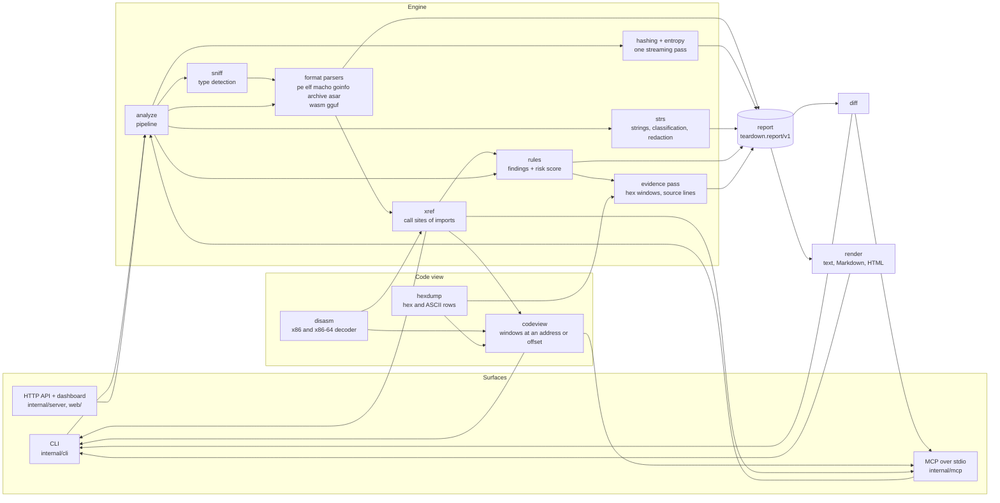
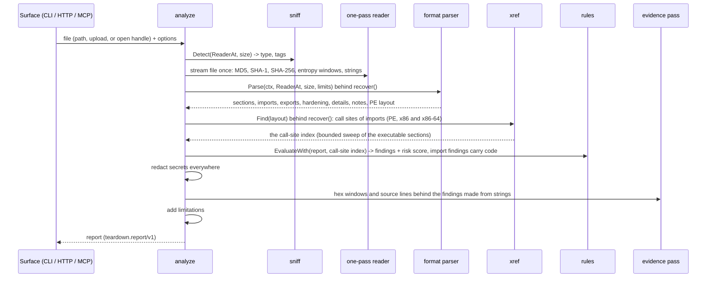
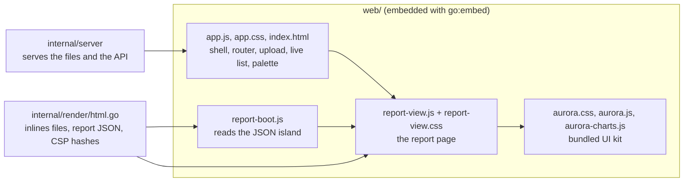

# Architecture

teardown is one Go module with no third-party dependencies. A single pipeline (`internal/analyze`)
produces a single data contract (`internal/report`), and every surface (CLI, HTTP API, MCP server,
dashboard, HTML report) is a thin shell around those two. A small x86 decoder and a few bounded readers
sit beside the pipeline and show the code behind its findings ([code evidence](code-evidence.md)).

## One analysis, step by step

## Packages

| Package | Responsibility |
|---|---|
| `internal/report` | The public data contract: `Report`, `Finding` (with its optional `code` blocks), constants for type, hardening and string IDs. A leaf package; additive-only after v1. |
| `internal/analyze` | The pipeline itself, the panic guard, the context deadline, secret scrubbing, report-wide limitations, and the evidence pass that adds hex windows and source lines behind the findings made from strings. |
| `internal/sniff` | Content-type detection by magic bytes plus light structure checks (reads head, tail and a few probes). |
| `internal/hashing`, `internal/entropy` | One streaming pass: digests, overall entropy and at most 512 entropy windows. |
| `internal/strs` | ASCII and UTF-16LE extraction, classification, secret detection and redaction. |
| `internal/format/<name>` | One parser per format; each returns facts for the report plus notes about what it could not read. |
| `internal/zipscan` | Bounded, tolerant ZIP central-directory reader shared by `sniff` and `format/archive`. |
| `internal/rules` | Findings and the risk score as pure functions of the report (and, for the code behind import findings, of a `CodeSource` the pipeline hands them). |
| `internal/disasm` | The x86 and x86-64 decoder: Intel syntax, linear sweep, never panics, bounded. Checked against `go tool objdump` by a developer test ([how](code-evidence.md#how-it-was-checked)). |
| `internal/hexdump` | Bounded hex and ASCII rows (16 bytes a row, at most 4096 bytes a window). |
| `internal/xref` | The call sites of the imports of a PE image: a bounded sweep of the executable sections with the decoder, matched against the import slots the PE parser keeps. Builds the instruction windows and the notes that name an import. |
| `internal/apiname` | How API names are matched (`CreateProcess` finds `CreateProcessA` and `CreateProcessW`), shared by the rules and `xref`. |
| `internal/codeview` | The windows behind `hexdump`, `disasm`, `read_bytes` and `disassemble`: address-to-offset mapping for PE, ELF and Mach-O images and the resulting code blocks. |
| `internal/render` | Terminal text (colour, unicode bars), Markdown and HTML views of a report, including the code blocks; sanitises untrusted text. |
| `internal/diff` | Structured comparison of two reports. |
| `internal/server` | HTTP API, security middleware, in-memory ring of analyses, server-sent events, OpenAPI document. |
| `internal/mcp` | MCP over stdio: JSON-RPC 2.0, eight tool schemas, root-confined file access, output caps and trimming. |
| `internal/cli` | Subcommands (`analyze`, `strings`, `hash`, `diff`, `disasm`, `xrefs`, `hexdump`, `serve`, `mcp`, `completion`, `version`), flags, help, completion scripts, exit codes. |
| `internal/binio`, `internal/limits` | Bounds-checked binary reading and the resource limits every parser honours. |
| `internal/testfixtures` | Programmatic builders for tiny valid PE, ELF, Mach-O, ZIP, ASAR, WebAssembly, GGUF, ... files. |
| `web/` | The embedded dashboard (`go:embed`): the bundled Aurora UI kit, the report view shared with `--html`, and the dashboard shell and router. |

## Design rules

- **Never execute the target.** Nothing is loaded, run, evaluated or decompressed beyond small,
  capped metadata entries. Uploads live in a private directory and are deleted right after analysis.
- **Bounded everywhere.** Every count, offset and size read from a file is validated against the file
  size before any allocation; every recorded list is capped by `limits.Limits`; every loop that can run
  long polls the context; the whole analysis has a deadline (60 s by default).
- **Panic-safe.** Each parser runs behind `recover`; a crash becomes a `parser.error` finding with a
  limitation, and the rest of the report survives. Fuzz targets call parsers directly so real panics
  are found, not hidden.
- **Evidence and limitations, always.** A finding without both is a bug; the risk score prints its own
  arithmetic.
- **Secrets are redacted in every output.** The scanner keeps the first four characters and the length,
  and a final scrub pass covers details and findings that could carry one from another route. Hex windows
  mask every byte of a credential, and a last pass covers the text of every code block.
- **Code evidence is a bounded view.** The decoder never panics and never looks past its input, the call-site
  sweep has byte, instruction and site limits, every block is capped (12 per finding, 64 lines each, 200
  characters per line) and says what it cannot show, and the renderers apply the caps again. Nothing is run:
  the code is read as bytes and decoded as text.
- **One contract, many views.** Rules read format details through their JSON form, so they behave the
  same on a stored report as on a fresh one, and they do not import any parser.
- **No global mutable state.** Command tables, rule registries and servers are built by functions and
  passed explicitly.

## Surfaces

- **CLI** (`teardown analyze|strings|hash|diff|disasm|xrefs|hexdump|serve|mcp|completion|version`): colour and
  unicode bars on terminals, `NO_COLOR` honoured, exit codes 0 / 1 / 2 and 3 for `--fail-on`. `analyze` prints the
  first code blocks under each finding (`--code-all`, `--no-code`); `disasm`, `xrefs` and `hexdump` read any part
  of a file.
- **HTTP API** (`teardown serve`): loopback by default, Host and Origin checks, strict headers, no CORS,
  streamed multipart uploads, bounded concurrency, server-sent events, OpenAPI 3.1 at `/api/openapi.json`.
- **MCP** (`teardown mcp`): hand-rolled JSON-RPC over stdio with protocol negotiation; eight read-only tools
  (the five that analyse, hash, list strings, profile entropy and diff, and `disassemble`, `find_calls` and
  `read_bytes` for the code); files readable only below configured roots (opened through `os.Root`), failures
  returned as tool results.
- **Dashboard** (`/` of `teardown serve`): upload with progress, a list of analyses that updates live over
  server-sent events, the report page with a Code panel inside each finding, a command palette; light and dark
  themes, offline, no inline script or style.
- **HTML report** (`teardown analyze --html`): the same report page as one offline file with its own
  Content-Security-Policy and a `<noscript>` summary.

## Dashboard and HTML report

The report page is written once, in `web/report-view.js`, and used twice: the dashboard mounts it
for `#/analysis/<id>` and `teardown analyze --html` inlines it into a single file. Both build the same
Aurora shell (a rail, a top bar with breadcrumbs, a sub bar and a status bar) with `Aurora.shell`, and
`TeardownView.dock` puts the sections of the report into its sub bar as tab pills: buttons that scroll in the
dashboard, which routes on the URL hash, and plain `#fragment` links in the exported file, which has no router.

- **Text only.** Names, strings and evidence from the analysed file are only ever handed to
  `textContent` (through `Aurora.el`) and pass through `vis()`, which spells out bidirectional
  overrides and other invisible characters. A test fails if the scripts use `innerHTML` or similar.
- **Strict CSP.** The dashboard needs no inline script or style, so it runs under the server's
  `default-src 'self'`. The exported file carries its own policy as a `<meta>` tag with the SHA-256 of
  its one script and one style element, plus `data:` images, and nothing else.
- **Safe JSON island.** `render.HTML` embeds the report with `json.Marshal` (which escapes `<`, `>`,
  `&`, U+2028 and U+2029) and `escapeInvisible` (every other invisible format character), so no file
  name or string can close the script element.
- **Same numbers as the engine.** The packing threshold and the risk bands that the view draws are
  constants in `report-view.js`; a test compares them with `rules.HighEntropySection` and `rules.Label`.
- **Strings from the API.** In the dashboard the strings table pages through
  `GET /api/analyses/{id}/strings`; in the exported file the same table filters the embedded list.
- **The Code panel.** Each finding's disclosure holds the blocks of `finding.code` as small monospace tables
  (address, bytes, instruction and note; offset, bytes and ASCII; line number and text). The caps are the ones
  of the Go model (a test keeps them equal), every cell passes through `vis()` and `textContent`, the flagged
  line has an arrow and a hidden label besides its tint, and a table that is wider than the screen scrolls
  inside its own focusable region, never the page. The same code runs in the dashboard and in the exported file.

## Testing

Table-driven unit tests per package; fixtures are generated in code (no third-party binaries); every
parser has a "never panics" sweep (every prefix length, corrupted bytes) and a native fuzz target; the
HTTP layer is tested with `httptest`, MCP over in-memory pipes (including root-escape and symlink
attempts); a self-analysis test analyses the test binary itself; a golden sample report pins the JSON
contract. The decoder has table-driven tests with encodings checked by hand, a fuzz target, and two developer
oracles that compare it with the Go toolchain; the call-site engine is tested on fixtures that contain real
code and on the Go test binary itself; the same fixtures feed golden outputs for the text, Markdown, JSON and
HTML forms of a finding with code, and a consistency test checks that `analyze`, `xrefs`, `find_calls` and
`disasm` agree about every call of the demo file. The dashboard assets are checked for completeness, CSP compatibility and the absence of
markup sinks, and the HTML report is tested with hostile file names, strings and U+2028.
